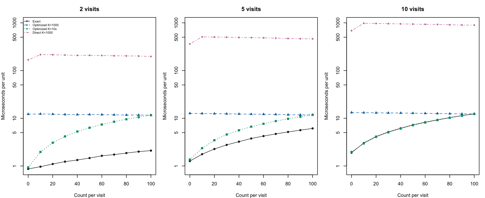
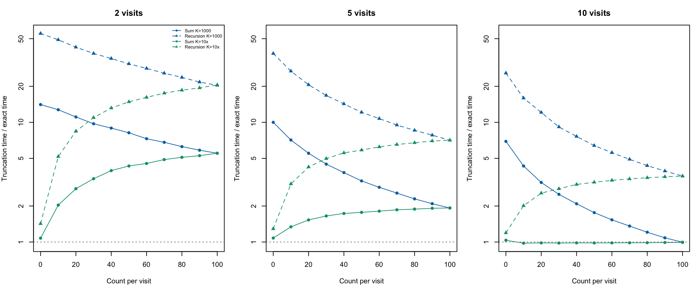

> Cached results preserved from the existing knitted HTML on 2026-10-25.
> No timings were rerun during conversion to the `.Rmd.orig` workflow.
> The displayed code reflects that run; edit and knit the `.Rmd.orig` source
> to refresh this snapshot. Rendering this `.Rmd` does not execute R code.

## Refreshing this cached article

The executable source is `n_mixture_benchmark.Rmd.orig`; the `.Rmd` is a
static snapshot for rendering without rerunning Stan or timings. Both live
under `vignettes/articles`, which is excluded from the CRAN source package.
Edit the `.orig` and regenerate the `.Rmd` only when new timings are wanted.

To refresh this article alone and render its cached HTML, run from the package root:

```r
source("inst/cache_vignettes.R")
cache_vignettes("n_mixture_benchmark", render_html = TRUE)
```

Omit `render_html = TRUE` to update only the cached `.Rmd`. Pass a vector of
vignette names to refresh a selection. Calling `cache_vignettes()` without a
selection refreshes all registered vignettes, including the long SBC articles;
sourcing the script itself does not run anything.

## Purpose and assumptions

This development benchmark compares the current exact Poisson/binomial
N-mixture likelihood with two implementations that sum over abundance
through **N = 1,000**, inclusive:

1.  The exact likelihood, with log coefficients precomputed in R.
2.  Optimized truncation, with log combinatorial weights precomputed in
    R and a vectorized log-sum-exp during evaluation.
3.  Direct truncation, calling the Poisson and binomial log PMFs at
    every possible abundance.

Every visit within a unit has the same observed count: 0, 10, ..., 100.
We consider 2, 5, and 10 visits. Detection probability is 0.5
throughout, and expected abundance is `max(1, 2 * count)`. The
truncation starts at the observed maximum and does not renormalize the
Poisson distribution. These parameter settings leave negligible
probability above the fixed cutoff. A separate check below uses
`K = max(10, 10 * count)` for optimized truncation only, so the
zero-count case uses a cutoff of 10.

Timings include likelihood evaluation and reverse-mode differentiation
through `rstan::grad_log_prob()`. Each call evaluates 20 identical units
to amortize R-interface overhead; results are divided by 20. Five timing
blocks per method use rotating method order and calibration to
approximately 0.15 seconds or more per block. We report the median.
Garbage collection occurs outside timed blocks. Compilation and
initialization are excluded. R coefficient precomputation is timed
separately; very short times may round to zero.

Before timing each configuration, likelihoods and all parameter
gradients must agree to absolute tolerance `1e-7`. These are local
likelihood-kernel measurements, not whole-model fitting speedups. Both
the exact polynomial evaluation and the optimized truncated sum use
vectorized expressions with precomputed data-only coefficients and
powers.
:::

::: {#setup .section .level2}
## Setup

Knit this document from the flocker source checkout. It requires the
development N-mixture helpers, `pkgload`, `rstan`, and a working Stan
C++ toolchain. The full benchmark takes several minutes. It does not run
the package test suite or SBC. This article is excluded from the CRAN
source package by `.Rbuildignore`.

By default, diagnostic files and CSV results go into a fresh temporary
directory. Supply `params = list(output_dir = "/path/to/results")` to
`rmarkdown::render()` to retain them elsewhere. No fitted-model objects
are saved.

``` r
# Find the checkout from the document directory or another directory within it.
package_root <- normalizePath(getwd())
while (!file.exists(file.path(package_root, 'DESCRIPTION'))) {
  parent <- dirname(package_root)
  if (identical(parent, package_root)) stop('Render from within the flocker checkout.')
  package_root <- parent
}
stopifnot(read.dcf(file.path(package_root, 'DESCRIPTION'))[1, 'Package'] == 'flocker')
pkgload::load_all(package_root, helpers = FALSE, quiet = TRUE)
library(rstan)
output_dir <- params$output_dir
if (is.null(output_dir)) output_dir <- tempfile('flocker-nmix-benchmark-')
dir.create(output_dir, recursive = TRUE, showWarnings = FALSE)
output_dir <- normalizePath(output_dir, mustWork = TRUE)
```
:::

::: {#stan-implementations .section .level2}
## Stan implementations

The exact implementation is read directly from the package's `.stan`
file. All four methods, including the recursion described below, share
the same compiled model and parameterization.

``` r
source_code <- paste(readLines(system.file('stan', 'n_mixture_poisson.stan', package = 'flocker', mustWork = TRUE)), collapse='\n')
code <- paste0('functions {', source_code, '
 real truncated_lpmf(array[] int y, vector eta, real log_lambda, int K) {
   int M = max(y);
   vector[K-M+1] terms;
   for (n in M:K) {
     terms[n-M+1] = poisson_log_lpmf(n | log_lambda);
     for (t in 1:num_elements(y))
       terms[n-M+1] += binomial_logit_lpmf(y[t] | n, eta[t]);
   }
   return log_sum_exp(terms);
 }
 real truncated_precomputed_lpmf(array[] int y, vector eta, real log_lambda,
                                  int M, vector log_weights, vector excess) {
   real log_q = sum(log1m_inv_logit(eta));
   real base = M * log_lambda - exp(log_lambda);
   for (t in 1:num_elements(y))
     base += y[t]*log_inv_logit(eta[t]) + (M-y[t])*log1m_inv_logit(eta[t]);
   return base + log_sum_exp(log_weights + excess * (log_lambda + log_q));
 }
 // Section 3 recursion generalized to visit-specific binomial detection.
 // log_ratio_factors contains (T-1)*log(N) - sum(log(N-y[t])),
 // for N=M+1,...,K, precomputed in R. Recurse backward on the log scale.
 real truncated_recursive_lpmf(array[] int y, vector eta, real log_lambda,
                               int M, real log_weight_start, vector log_ratio_factors) {
   real log_theta = log_lambda + sum(log1m_inv_logit(eta));
   real base = M * log_lambda - exp(log_lambda) + log_weight_start;
   real log_nested_sum = 0;
   int steps = num_elements(log_ratio_factors);
   for (t in 1:num_elements(y))
     base += y[t]*log_inv_logit(eta[t]) + (M-y[t])*log1m_inv_logit(eta[t]);
   if (steps > 0) {
     for (i in 1:steps) {
       int j = steps - i + 1;
       log_nested_sum = log1p_exp(log_theta + log_ratio_factors[j] + log_nested_sum);
     }
   }
   return base + log_nested_sum;
 }
}
data {
 int T; array[T] int y; int M; int C; vector[C] lc; vector[C] coef_power; real lf;
 int K; vector[K-M+1] log_weights; vector[K-M+1] excess;
 vector[K-M] log_ratio_factors;
 int method; int batch;
}
parameters { real log_lambda; vector[T] eta; }
model {
 for (i in 1:batch) {
   if (method == 1) target += n_mixture_poisson_unit_lpmf(y | eta, log_lambda, M, lf, lc, coef_power);
   else if (method == 2) target += truncated_precomputed_lpmf(y | eta, log_lambda, M, log_weights, excess);
   else if (method == 3) target += truncated_lpmf(y | eta, log_lambda, K);
   else target += truncated_recursive_lpmf(y | eta, log_lambda, M, log_weights[1], log_ratio_factors);
 }
}')
writeLines(code, file.path(output_dir, 'benchmark.stan'))
```

``` r
sm <- stan_model(model_code = code)
```
:::

::: {#run-the-benchmark .section .level2}
## Run the benchmark

The single fixed-parameter iteration initializes the Stan model so its
density and gradient methods can be called. It does not perform
posterior sampling.

``` r
results <- list()
exact_reference <- list()
# Parameter-independent factors for successive-term ratios. When K=M the
# empty vector makes the recursion return the single starting term.
recursion_factors <- function(y, K) {
  N <- seq.int(max(y), K)[-1]
  as.array((length(y) - 1) * log(N) -
    vapply(N, function(n) sum(log(n - y)), numeric(1)))
}
idx <- 0L
batch <- 20L
timed <- function(f, calls) {
  unname(system.time(for (i in seq_len(calls)) f())[['elapsed']])
}
for (T in c(2L,5L,10L)) for (count in seq.int(0L,100L,10L)) {
  y <- rep(count,T)
  # Positive abundance even for all-zero histories; far below the cutoff.
  lambda <- max(1,2*count)
  eta <- rep(0,T)
  pars <- c(log(lambda),eta)
  pre_calls <- 20L
  prep_ms <- 1000*timed(function() n_mixture_log_coefficients(y),pre_calls)/pre_calls
  lc <- n_mixture_log_coefficients(y)
  N <- count:1000L
  weights <- -lgamma(N+1)
  for (n in y) weights <- weights + lchoose(N,n)
  d <- list(T=T,y=as.array(y),M=count,C=length(lc),lc=as.array(lc),
    coef_power=as.array(as.numeric(seq_along(lc)-1L)),
    lf=sum(lgamma(y+1)),K=1000L,log_weights=as.array(weights),
    excess=as.array(as.numeric(N-count)),batch=batch,
    log_ratio_factors=recursion_factors(y, 1000L))
  fits <- lapply(1:3,function(method) sampling(sm,data=c(d,list(method=method)),
    algorithm='Fixed_param',chains=1,iter=1,warmup=0,refresh=0,seed=1,
    init=list(list(log_lambda=log(lambda),eta=as.array(eta)))))
  lp <- vapply(fits,function(f) log_prob(f,pars),numeric(1))/batch
  grad <- lapply(fits,function(f) as.numeric(grad_log_prob(f,pars))/batch)
  stopifnot(max(abs(lp-lp[1]))<1e-7,
            max(abs(grad[[1]]-grad[[2]]))<1e-7,
            max(abs(grad[[1]]-grad[[3]]))<1e-7)
  for (f in fits) for (i in 1:5) grad_log_prob(f,pars)
  # Calibrate to >= 0.15 seconds per timing block to avoid clock granularity.
  calls <- vapply(fits,function(f) {
    elapsed <- timed(function() grad_log_prob(f,pars),10L)
    as.integer(max(10,ceiling(10*0.15/max(elapsed,0.001))))
  },integer(1))
  times <- matrix(NA_real_,5,3)
  for (round in 1:5) for (method in ((seq_len(3)+round-2) %% 3)+1) {
    gc()
    times[round,method] <- 1e6*timed(function() grad_log_prob(fits[[method]],pars),calls[method])/
      calls[method]/batch
  }
  idx <- idx+1L
  # Retain exact values, gradients, and inputs for the separate cutoff check.
  # This avoids rerunning or retiming the exact method in that check.
  exact_reference[[paste(T, count, sep = '_')]] <- list(
    data = d, pars = pars, lp = lp[1], gradient = grad[[1]],
    optimized_lp = lp[2], optimized_gradient = grad[[2]])
  results[[idx]] <- data.frame(visits=T,count=count,degree=length(lc)-1,
    lambda=lambda,precompute_ms=prep_ms,
    exact_us=median(times[,1]),truncated_precomputed_us=median(times[,2]),
    truncated_direct_us=median(times[,3]),
    optimized_speedup=median(times[,2])/median(times[,1]),
    direct_speedup=median(times[,3])/median(times[,1]),
    max_loglik_difference=max(abs(lp-lp[1])),
    max_gradient_difference=max(abs(grad[[1]]-grad[[2]]),abs(grad[[1]]-grad[[3]])))
  saveRDS(list(results=results,times=times,calls=calls),file.path(output_dir, 'progress.rds'))
  write.csv(do.call(rbind,results),file.path(output_dir, 'results.csv'),row.names=FALSE)
  cat(sprintf('visits=%d count=%d exact=%.2fus optimized=%.2fus direct=%.2fus ratio=%.2fx\n',
      T,count,median(times[,1]),median(times[,2]),median(times[,3]),median(times[,2])/median(times[,1])))
  flush.console()
}
```

    ## visits=2 count=0 exact=0.87us optimized=12.20us direct=167.39us ratio=14.08x
    ## visits=2 count=10 exact=0.97us optimized=12.32us direct=215.71us ratio=12.74x
    ## visits=2 count=20 exact=1.10us optimized=12.20us direct=214.29us ratio=11.09x
    ## visits=2 count=30 exact=1.23us optimized=12.00us direct=211.11us ratio=9.73x
    ## visits=2 count=40 exact=1.33us optimized=11.93us direct=208.33us ratio=8.95x
    ## visits=2 count=50 exact=1.47us optimized=12.00us direct=208.33us ratio=8.18x
    ## visits=2 count=60 exact=1.63us optimized=11.92us direct=206.76us ratio=7.30x
    ## visits=2 count=70 exact=1.73us optimized=11.80us direct=203.95us ratio=6.81x
    ## visits=2 count=80 exact=1.87us optimized=11.70us direct=202.70us ratio=6.27x
    ## visits=2 count=90 exact=2.00us optimized=11.70us direct=201.32us ratio=5.85x
    ## visits=2 count=100 exact=2.10us optimized=11.58us direct=197.37us ratio=5.52x
    ## visits=5 count=0 exact=1.27us optimized=12.67us direct=361.90us ratio=10.01x
    ## visits=5 count=10 exact=1.77us optimized=12.57us direct=506.67us ratio=7.12x
    ## visits=5 count=20 exact=2.27us optimized=12.50us direct=503.33us ratio=5.51x
    ## visits=5 count=30 exact=2.77us optimized=12.38us direct=500.00us ratio=4.48x
    ## visits=5 count=40 exact=3.23us optimized=12.30us direct=493.75us ratio=3.80x
    ## visits=5 count=50 exact=3.77us optimized=12.20us direct=490.63us ratio=3.24x
    ## visits=5 count=60 exact=4.23us optimized=12.13us direct=484.37us ratio=2.87x
    ## visits=5 count=70 exact=4.70us optimized=12.05us direct=478.12us ratio=2.56x
    ## visits=5 count=80 exact=5.17us optimized=11.85us direct=468.75us ratio=2.29x
    ## visits=5 count=90 exact=5.63us optimized=11.78us direct=464.71us ratio=2.09x
    ## visits=5 count=100 exact=6.13us optimized=11.78us direct=461.76us ratio=1.92x
    ## visits=10 count=0 exact=1.90us optimized=13.17us direct=686.36us ratio=6.93x
    ## visits=10 count=10 exact=3.03us optimized=13.10us direct=980.00us ratio=4.32x
    ## visits=10 count=20 exact=4.13us optimized=13.00us direct=970.00us ratio=3.15x
    ## visits=10 count=30 exact=5.17us optimized=12.93us direct=960.00us ratio=2.50x
    ## visits=10 count=40 exact=6.17us optimized=12.87us direct=950.00us ratio=2.09x
    ## visits=10 count=50 exact=7.26us optimized=12.77us direct=940.00us ratio=1.76x
    ## visits=10 count=60 exact=8.27us optimized=12.67us direct=930.00us ratio=1.53x
    ## visits=10 count=70 exact=9.27us optimized=12.60us direct=925.00us ratio=1.36x
    ## visits=10 count=80 exact=10.33us optimized=12.48us direct=910.00us ratio=1.21x
    ## visits=10 count=90 exact=11.38us optimized=12.33us direct=900.00us ratio=1.08x
    ## visits=10 count=100 exact=12.38us optimized=12.33us direct=895.00us ratio=1.00x
:::

::: {#results .section .level2}
## Results

Ratios above one mean that the exact implementation is faster; ratios
below one mean truncation is faster. Ratios close to one should be
treated as a tie unless repeated measurements establish a difference.

``` r
results <- do.call(rbind, results)
speedups <- reshape(results[c('count', 'visits', 'optimized_speedup')],
                    idvar = 'count', timevar = 'visits', direction = 'wide')
names(speedups) <- c('Count per visit', '2 visits', '5 visits', '10 visits')
knitr::kable(speedups, digits = 2, row.names = FALSE,
             caption = 'Exact speedup relative to optimized truncation')
```

    Count per visit   2 visits   5 visits   10 visits
  ----------------- ---------- ---------- -----------
                  0      14.08      10.01        6.93
                 10      12.74       7.12        4.32
                 20      11.09       5.51        3.15
                 30       9.73       4.48        2.50
                 40       8.95       3.80        2.09
                 50       8.18       3.24        1.76
                 60       7.30       2.87        1.53
                 70       6.81       2.56        1.36
                 80       6.27       2.29        1.21
                 90       5.85       2.09        1.08
                100       5.52       1.92        1.00

  : Exact speedup relative to optimized truncation

``` r
knitr::kable(results[c('visits', 'count', 'precompute_ms', 'exact_us',
                       'truncated_precomputed_us', 'truncated_direct_us')],
             digits = 3, row.names = FALSE,
             caption = 'Precomputation in milliseconds; gradient evaluation in microseconds per unit')
```

  --------------------------------------------------------------------------------------------
    visits   count   precompute_ms   exact_us   truncated_precomputed_us   truncated_direct_us
  -------- ------- --------------- ---------- -------------------------- ---------------------
         2       0            0.30      0.867                     12.200               167.391

         2      10            0.10      0.967                     12.317               215.714

         2      20            0.10      1.100                     12.200               214.286

         2      30            0.20      1.233                     12.000               211.111

         2      40            0.25      1.333                     11.933               208.333

         2      50            0.30      1.467                     12.000               208.333

         2      60            0.35      1.633                     11.917               206.757

         2      70            0.50      1.733                     11.800               203.947

         2      80            0.50      1.867                     11.700               202.703

         2      90            0.60      2.000                     11.700               201.316

         2     100            0.75      2.100                     11.585               197.368

         5       0            0.00      1.267                     12.675               361.905

         5      10            0.25      1.767                     12.575               506.667

         5      20            0.50      2.267                     12.500               503.333

         5      30            0.85      2.767                     12.383               500.000

         5      40            1.25      3.233                     12.300               493.750

         5      50            1.70      3.767                     12.200               490.625

         5      60            2.15      4.233                     12.133               484.375

         5      70            2.55      4.700                     12.051               478.125

         5      80            3.00      5.167                     11.851               468.750

         5      90            3.60      5.633                     11.776               464.706

         5     100            4.55      6.125                     11.776               461.765

        10       0            0.00      1.900                     13.174               686.364

        10      10            0.60      3.033                     13.100               980.000

        10      20            1.40      4.133                     13.000               970.000

        10      30            2.35      5.167                     12.933               960.000

        10      40            3.40      6.167                     12.874               950.000

        10      50            5.10      7.257                     12.774               940.000

        10      60            6.60      8.267                     12.667               930.000

        10      70            8.80      9.267                     12.600               925.000

        10      80           11.30     10.333                     12.475               910.000

        10      90           13.15     11.377                     12.333               900.000

        10     100           15.55     12.383                     12.333               895.000
  --------------------------------------------------------------------------------------------

  : Precomputation in milliseconds; gradient evaluation in microseconds
  per unit

``` r
c(max_loglik_difference = max(results$max_loglik_difference),
  max_gradient_difference = max(results$max_gradient_difference))
```

    ##   max_loglik_difference max_gradient_difference
    ##            2.891909e-12            1.226397e-11

``` r
output_dir
```

    ## [1] "/private/var/folders/52/5l_0lt6d73j_p9p24drhyly00000gn/T/RtmpQ3z3ew/flocker-nmix-benchmark-3c4f1b93b01b"
:::

:::: {#optimized-truncation-with-a-count-dependent-cutoff .section .level2}
## Optimized truncation with a count-dependent cutoff

This separate check times **only the optimized truncated likelihood**,
using `K = max(10, 10 * count)` instead of 1,000. It reuses the compiled
model and the exact values, gradients, and timings from the first
benchmark. Detection probabilities, abundance means, batches, warmup
calls, and timing calibration are unchanged. The comparison therefore
uses separate timing blocks, not interleaved timings between the two
cutoff rules.

For count zero, we use `K = 10` because positive abundance can produce
all-zero observations. We report approximation errors and flag any
speedup for an inaccurate approximation. Unlike the fixed-cutoff
benchmark, this check records agreement rather than asserting it. The
error columns are absolute differences from the exact per-unit log
likelihood and the largest absolute difference across its parameter
gradients.

``` r
count_cutoff_results <- list()
count_cutoff_reference <- list()
for (key in names(exact_reference)) {
  reference <- exact_reference[[key]]
  d <- reference$data
  pars <- reference$pars
  count <- d$M
  d$K <- as.integer(max(10L, 10L * count))
  N <- seq.int(count, d$K)
  weights <- -lgamma(N + 1)
  for (n in d$y) weights <- weights + lchoose(N, n)
  d$log_weights <- as.array(weights)
  d$excess <- as.array(as.numeric(N - count))
  d$log_ratio_factors <- recursion_factors(d$y, d$K)
  fit <- sampling(sm, data = c(d, list(method = 2L)),
    algorithm = 'Fixed_param', chains = 1, iter = 1, warmup = 0,
    refresh = 0, seed = 1,
    init = list(list(log_lambda = pars[1], eta = as.array(pars[-1]))))
  lp <- log_prob(fit, pars) / d$batch
  gradient <- as.numeric(grad_log_prob(fit, pars)) / d$batch
  count_cutoff_reference[[key]] <- list(data = d, lp = lp, gradient = gradient)
  lp_error <- abs(lp - reference$lp)
  gradient_error <- max(abs(gradient - reference$gradient))
  for (i in 1:5) grad_log_prob(fit, pars)
  elapsed <- timed(function() grad_log_prob(fit, pars), 10L)
  calls <- as.integer(max(10, ceiling(10 * 0.15 / max(elapsed, 0.001))))
  times <- numeric(5)
  for (round in 1:5) {
    gc()
    times[round] <- 1e6 * timed(function() grad_log_prob(fit, pars), calls) /
      calls / d$batch
  }
  count_cutoff_results[[key]] <- data.frame(
    visits = d$T, count = count, cutoff = d$K,
    count_cutoff_us = median(times),
    loglik_error = lp_error, gradient_error = gradient_error,
    agrees = lp_error < 1e-7 && gradient_error < 1e-7)
  write.csv(do.call(rbind, count_cutoff_results),
            file.path(output_dir, 'count-cutoff-results.csv'), row.names = FALSE)
}
count_cutoff_results <- do.call(rbind, count_cutoff_results)
comparison <- merge(results, count_cutoff_results, by = c('visits', 'count'))
comparison <- comparison[order(comparison$visits, comparison$count), ]
comparison$count_cutoff_speedup <- comparison$count_cutoff_us / comparison$exact_us
write.csv(comparison, file.path(output_dir, 'cutoff-comparison.csv'), row.names = FALSE)
```

::: {#timing-and-accuracy-comparison .section .level3}
### Timing and accuracy comparison

The labels "10x" below include the minimum cutoff of 10.

Both speedup columns use truncation time divided by exact time: values
above one favor the exact method. Rows marked `agrees = FALSE` compare
computations that are not numerically equivalent at the tested parameter
values.

``` r
knitr::kable(comparison[c('visits', 'count', 'cutoff', 'exact_us',
  'truncated_precomputed_us', 'count_cutoff_us', 'optimized_speedup',
  'count_cutoff_speedup', 'agrees')], digits = 3, row.names = FALSE,
  col.names = c('Visits', 'Count', '10x cutoff', 'Exact (us)',
    'Optimized K=1000 (us)', 'Optimized K=10x (us)', 'Exact speedup vs K=1000',
    'Exact speedup vs K=10x', 'Agrees'),
  caption = 'Gradient timings per unit and exact-method speedups')
```

  ---------------------------------------------------------------------------------------------
    Visits   Count      10x    Exact   Optimized   Optimized        Exact        Exact Agrees
                     cutoff     (us) K=1000 (us)  K=10x (us)   speedup vs   speedup vs
                                                                   K=1000        K=10x
  -------- ------- -------- -------- ----------- ----------- ------------ ------------ --------
         2       0       10    0.867      12.200       0.933       14.077        1.077 TRUE

         2      10      100    0.967      12.317       1.967       12.742        2.034 TRUE

         2      20      200    1.100      12.200       3.067       11.091        2.788 TRUE

         2      30      300    1.233      12.000       4.167        9.730        3.378 TRUE

         2      40      400    1.333      11.933       5.267        8.950        3.950 TRUE

         2      50      500    1.467      12.000       6.333        8.182        4.318 TRUE

         2      60      600    1.633      11.917       7.400        7.296        4.531 TRUE

         2      70      700    1.733      11.800       8.467        6.808        4.885 TRUE

         2      80      800    1.867      11.700       9.521        6.268        5.100 TRUE

         2      90      900    2.000      11.700      10.533        5.850        5.267 TRUE

         2     100     1000    2.100      11.585      11.600        5.516        5.524 TRUE

         5       0       10    1.267      12.675       1.367       10.006        1.079 TRUE

         5      10      100    1.767      12.575       2.367        7.118        1.340 TRUE

         5      20      200    2.267      12.500       3.467        5.515        1.529 TRUE

         5      30      300    2.767      12.383       4.567        4.476        1.651 TRUE

         5      40      400    3.233      12.300       5.600        3.804        1.732 TRUE

         5      50      500    3.767      12.200       6.667        3.239        1.770 TRUE

         5      60      600    4.233      12.133       7.667        2.866        1.811 TRUE

         5      70      700    4.700      12.051       8.733        2.564        1.858 TRUE

         5      80      800    5.167      11.851       9.733        2.294        1.884 TRUE

         5      90      900    5.633      11.776      10.778        2.090        1.913 TRUE

         5     100     1000    6.125      11.776      11.800        1.923        1.926 TRUE

        10       0       10    1.900      13.174       1.967        6.934        1.035 TRUE

        10      10      100    3.033      13.100       2.967        4.319        0.978 TRUE

        10      20      200    4.133      13.000       4.067        3.145        0.984 TRUE

        10      30      300    5.167      12.933       5.067        2.503        0.981 TRUE

        10      40      400    6.167      12.874       6.067        2.088        0.984 TRUE

        10      50      500    7.257      12.774       7.133        1.760        0.983 TRUE

        10      60      600    8.267      12.667       8.133        1.532        0.984 TRUE

        10      70      700    9.267      12.600       9.133        1.360        0.986 TRUE

        10      80      800   10.333      12.475      10.200        1.207        0.987 TRUE

        10      90      900   11.377      12.333      11.277        1.084        0.991 TRUE

        10     100     1000   12.383      12.333      12.300        0.996        0.993 TRUE
  ---------------------------------------------------------------------------------------------

  : Gradient timings per unit and exact-method speedups

``` r
knitr::kable(comparison[c('visits', 'count', 'loglik_error', 'gradient_error')],
  digits = 12, row.names = FALSE,
  caption = 'Absolute errors for the count-dependent cutoff relative to exact evaluation')
```

    visits   count   loglik_error   gradient_error
  -------- ------- -------------- ----------------
         2       0          0e+00          0.0e+00
         2      10          0e+00          0.0e+00
         2      20          0e+00          0.0e+00
         2      30          0e+00          0.0e+00
         2      40          0e+00          0.0e+00
         2      50          0e+00          0.0e+00
         2      60          0e+00          1.0e-12
         2      70          0e+00          1.0e-12
         2      80          0e+00          0.0e+00
         2      90          0e+00          2.0e-12
         2     100          0e+00          3.0e-12
         5       0          0e+00          0.0e+00
         5      10          0e+00          0.0e+00
         5      20          0e+00          0.0e+00
         5      30          0e+00          0.0e+00
         5      40          0e+00          2.0e-12
         5      50          0e+00          0.0e+00
         5      60          0e+00          2.0e-12
         5      70          0e+00          7.0e-12
         5      80          0e+00          6.0e-12
         5      90          0e+00          3.0e-12
         5     100          0e+00          6.0e-12
        10       0          0e+00          0.0e+00
        10      10          0e+00          0.0e+00
        10      20          0e+00          0.0e+00
        10      30          0e+00          1.0e-12
        10      40          2e-12          2.0e-12
        10      50          3e-12          2.0e-12
        10      60          0e+00          1.0e-11
        10      70          2e-12          1.0e-11
        10      80          2e-12          1.2e-11
        10      90          1e-12          3.0e-12
        10     100          2e-12          6.0e-12

  : Absolute errors for the count-dependent cutoff relative to exact
  evaluation

The plot includes the original direct truncation for context. Times use
a logarithmic scale; red crosses flag count-dependent timings whose
likelihood or gradient failed the agreement tolerance.

``` r
local({
  old_par <- par(mfrow = c(1, 3), mar = c(4, 4, 3, 1))
  on.exit(par(old_par))
  colors <- c('#222222', '#0072B2', '#009E73', '#CC79A7')
  columns <- c('exact_us', 'truncated_precomputed_us',
               'count_cutoff_us', 'truncated_direct_us')
  limits <- range(as.matrix(comparison[columns]))
  for (visits in sort(unique(comparison$visits))) {
    panel <- comparison[comparison$visits == visits, ]
    matplot(panel$count, as.matrix(panel[columns]), type = 'o', log = 'y',
      lty = c(1, 2, 3, 4), pch = c(16, 17, 15, 18), col = colors,
      ylim = limits, xlab = 'Count per visit', ylab = 'Microseconds per unit',
      main = paste(visits, 'visits'))
    bad <- !panel$agrees
    points(panel$count[bad], panel$count_cutoff_us[bad], pch = 4,
           col = 'red', cex = 1.6, lwd = 2)
    if (visits == min(comparison$visits)) {
      legend('topleft', c('Exact', 'Optimized K=1000', 'Optimized K=10x',
                         'Direct K=1000'), col = colors,
             lty = 1:4, pch = c(16, 17, 15, 18), cex = 0.65, bty = 'n')
    }
  }
})
```

{role="img"
aria-label="" width="1056"}
:::
::::

:::: {#recursive-optimized-truncation-at-both-cutoffs .section .level2}
## Recursive optimized truncation at both cutoffs

Section 3 of Goldstein and de Valpine's supplemental materials for
*Comparing N-mixture models and GLMMs for relative abundance estimation
in a citizen science dataset* (2022; supplement
`41598_2022_16368_MOESM1_ESM.pdf`) describes successive-term ratios and
a nested summation adapted from Meehan et al. The existing optimized
benchmark **does not use that recursion**: it precomputes log
combinatorial weights and evaluates all terms with one vectorized
log-sum-exp. Both approaches avoid repeated factorial calculations.

For multiple visits, let [\\(a_N =
\\Pr(N\\mid\\lambda)\\prod_t\\Pr(y_t\\mid N,p_t)\\)]{.math .inline},
[\\(M=\\max_t y_t\\)]{.math .inline}, and
[\\(q=\\prod_t(1-p_t)\\)]{.math .inline}. Combining the Poisson and
binomial recursions gives, for [\\(N\>M\\)]{.math .inline},

[\\\[ \\frac{a_N}{a\_{N-1}} = \\lambda
q\\,\\frac{N\^{T-1}}{\\prod_t(N-y_t)} = r_N. \\\]]{.math .display}

Thus the truncated likelihood is
[\\(a_M\[1+r\_{M+1}(1+r\_{M+2}(\\ldots(1+r_K)\\ldots))\]\\)]{.math
.inline}. The data-only quantity [\\((T-1)\\log
N-\\sum_t\\log(N-y_t)\\)]{.math .inline} is precomputed in R. Starting
with [\\(s=0\\)]{.math .inline}, we work backward from [\\(N=K\\)]{.math
.inline} to [\\(M+1\\)]{.math .inline}, updating
[\\(s=\\log(1+\\exp(\\log r_N+s))\\)]{.math .inline}, and finally return
[\\(\\log a_M+s\\)]{.math .inline}. `log1p_exp` makes the recursion
stable without forming tiny probabilities or large products. This is the
multiple-visit version of the nested recursion; the single-observation
factor in the supplement cannot be used unchanged.

The new pair of benchmarks times **only method 4**, at `K=1000` and
`K=max(10, 10*count)`. It reuses earlier exact and optimized-sum
results. Each recursive result must agree with the existing optimized
implementation at the **same cutoff** to `1e-7` in log likelihood and
gradients before it is timed. Its error relative to the exact likelihood
is recorded separately, so truncation error is not mistaken for a
recursion error. Data preparation is outside the timed gradient calls,
as for the other optimized methods. The two recursive cutoff settings
are timed in alternating order across five blocks; comparisons with
earlier methods still use separate benchmark runs.

``` r
recursive_results <- list()
for (key in names(exact_reference)) {
  reference <- exact_reference[[key]]
  pars <- reference$pars
  configurations <- list(
    fixed = list(data = reference$data, lp = reference$optimized_lp,
                 gradient = reference$optimized_gradient),
    count = count_cutoff_reference[[key]])
  fits <- lapply(configurations, function(configuration) {
    sampling(sm, data = c(configuration$data, list(method = 4L)),
      algorithm = 'Fixed_param', chains = 1, iter = 1, warmup = 0,
      refresh = 0, seed = 1,
      init = list(list(log_lambda = pars[1], eta = as.array(pars[-1]))))
  })
  checks <- lapply(seq_along(fits), function(i) {
    d <- configurations[[i]]$data
    lp <- log_prob(fits[[i]], pars) / d$batch
    gradient <- as.numeric(grad_log_prob(fits[[i]], pars)) / d$batch
    same_cutoff_lp_error <- abs(lp - configurations[[i]]$lp)
    same_cutoff_gradient_error <- max(abs(gradient - configurations[[i]]$gradient))
    stopifnot(same_cutoff_lp_error < 1e-7, same_cutoff_gradient_error < 1e-7)
    c(loglik_error = abs(lp - reference$lp),
      gradient_error = max(abs(gradient - reference$gradient)),
      same_cutoff_loglik_error = same_cutoff_lp_error,
      same_cutoff_gradient_error = same_cutoff_gradient_error)
  })
  for (fit in fits) for (i in 1:5) grad_log_prob(fit, pars)
  calls <- vapply(fits, function(fit) {
    elapsed <- timed(function() grad_log_prob(fit, pars), 10L)
    as.integer(max(10, ceiling(10 * 0.15 / max(elapsed, 0.001))))
  }, integer(1))
  times <- matrix(NA_real_, 5, 2)
  for (round in 1:5) for (i in if (round %% 2) 1:2 else 2:1) {
    gc()
    times[round, i] <- 1e6 * timed(function() grad_log_prob(fits[[i]], pars), calls[i]) /
      calls[i] / configurations[[i]]$data$batch
  }
  for (i in seq_along(fits)) {
    d <- configurations[[i]]$data
    errors <- checks[[i]]
    recursive_results[[paste(key, names(configurations)[i], sep = '_')]] <- data.frame(
      visits = d$T, count = d$M, cutoff_rule = names(configurations)[i], cutoff = d$K,
      recursive_us = median(times[, i]),
      loglik_error = errors[['loglik_error']],
      gradient_error = errors[['gradient_error']],
      same_cutoff_loglik_error = errors[['same_cutoff_loglik_error']],
      same_cutoff_gradient_error = errors[['same_cutoff_gradient_error']],
      agrees = errors[['loglik_error']] < 1e-7 && errors[['gradient_error']] < 1e-7)
  }
  write.csv(do.call(rbind, recursive_results),
            file.path(output_dir, 'recursive-results.csv'), row.names = FALSE)
}
recursive_results <- do.call(rbind, recursive_results)
recursive_comparison <- merge(comparison, reshape(
  recursive_results[c('visits', 'count', 'cutoff_rule', 'recursive_us', 'agrees')],
  idvar = c('visits', 'count'), timevar = 'cutoff_rule', direction = 'wide'),
  by = c('visits', 'count'))
recursive_comparison <- recursive_comparison[
  order(recursive_comparison$visits, recursive_comparison$count), ]
recursive_comparison$recursive_fixed_speedup <-
  recursive_comparison$recursive_us.fixed / recursive_comparison$exact_us
recursive_comparison$recursive_count_speedup <-
  recursive_comparison$recursive_us.count / recursive_comparison$exact_us
write.csv(recursive_comparison, file.path(output_dir, 'recursive-comparison.csv'), row.names = FALSE)
```

::: {#all-methods-side-by-side .section .level3}
### All methods side by side

``` r
knitr::kable(recursive_comparison[c('visits', 'count', 'exact_us',
  'truncated_direct_us', 'truncated_precomputed_us', 'recursive_us.fixed',
  'count_cutoff_us', 'recursive_us.count')], digits = 3, row.names = FALSE,
  col.names = c('Visits', 'Count', 'Exact', 'Direct K=1000',
                'Optimized K=1000', 'Recursive K=1000', 'Optimized K=10x',
                'Recursive K=10x'),
  caption = 'Gradient evaluation in microseconds per unit (10x has a minimum of 10)')
```

  -------------------------------------------------------------------------------------
    Visits   Count    Exact    Direct    Optimized    Recursive   Optimized   Recursive
                               K=1000       K=1000       K=1000       K=10x       K=10x
  -------- ------- -------- --------- ------------ ------------ ----------- -----------
         2       0    0.867   167.391       12.200       47.904       0.933       1.233

         2      10    0.967   215.714       12.317       47.305       1.967       5.000

         2      20    1.100   214.286       12.200       46.689       3.067       9.267

         2      30    1.233   211.111       12.000       46.407       4.167      13.500

         2      40    1.333   208.333       11.933       45.509       5.267      17.565

         2      50    1.467   208.333       12.000       45.210       6.333      21.761

         2      60    1.633   206.757       11.917       46.108       7.400      26.412

         2      70    1.733   203.947       11.800       44.611       8.467      30.400

         2      80    1.867   202.703       11.700       44.311       9.521      34.651

         2      90    2.000   201.316       11.700       43.413      10.533      38.830

         2     100    2.100   197.368       11.585       42.819      11.600      43.114

         5       0    1.267   361.905       12.675       47.605       1.367       1.633

         5      10    1.767   506.667       12.575       47.305       2.367       5.400

         5      20    2.267   503.333       12.500       46.689       3.467       9.600

         5      30    2.767   500.000       12.383       46.407       4.567      13.772

         5      40    3.233   493.750       12.300       46.108       5.600      17.964

         5      50    3.767   490.625       12.200       45.667       6.667      22.093

         5      60    4.233   484.375       12.133       45.509       7.667      26.400

         5      70    4.700   478.125       12.051       44.611       8.733      30.677

         5      80    5.167   468.750       11.851       44.311       9.733      34.884

         5      90    5.633   464.706       11.776       44.012      10.778      39.362

         5     100    6.125   461.765       11.776       43.413      11.800      43.351

        10       0    1.900   686.364       13.174       49.007       1.967       2.267

        10      10    3.033   980.000       13.100       48.344       2.967       6.100

        10      20    4.133   970.000       13.000       50.000       4.067      10.586

        10      30    5.167   960.000       12.933       47.305       5.067      14.400

        10      40    6.167   950.000       12.874       47.020       6.067      18.667

        10      50    7.257   940.000       12.774       46.407       7.133      22.924

        10      60    8.267   930.000       12.667       46.108       8.133      27.076

        10      70    9.267   925.000       12.600       45.509       9.133      31.200

        10      80   10.333   910.000       12.475       44.910      10.200      35.581

        10      90   11.377   900.000       12.333       44.611      11.277      39.894

        10     100   12.383   895.000       12.333       44.012      12.300      44.012
  -------------------------------------------------------------------------------------

  : Gradient evaluation in microseconds per unit (10x has a minimum of
  10)

``` r
knitr::kable(recursive_results[c('visits', 'count', 'cutoff_rule',
  'same_cutoff_loglik_error', 'same_cutoff_gradient_error',
  'loglik_error', 'gradient_error', 'agrees')], digits = 12, row.names = FALSE,
  caption = 'Recursion agreement with the optimized sum and error relative to exact evaluation')
```

  -------------------------------------------------------------------------------------------------------------------------------
    visits   count cutoff_rule     same_cutoff_loglik_error   same_cutoff_gradient_error   loglik_error   gradient_error agrees
  -------- ------- ------------- -------------------------- ---------------------------- -------------- ---------------- --------
         2       0 fixed                                  0                        0e+00          0e+00          0.0e+00 TRUE

         2       0 count                                  0                        0e+00          0e+00          0.0e+00 TRUE

         2      10 fixed                                  0                        0e+00          0e+00          0.0e+00 TRUE

         2      10 count                                  0                        0e+00          0e+00          0.0e+00 TRUE

         2      20 fixed                                  0                        0e+00          0e+00          0.0e+00 TRUE

         2      20 count                                  0                        0e+00          0e+00          0.0e+00 TRUE

         2      30 fixed                                  0                        0e+00          0e+00          0.0e+00 TRUE

         2      30 count                                  0                        0e+00          0e+00          0.0e+00 TRUE

         2      40 fixed                                  0                        0e+00          0e+00          0.0e+00 TRUE

         2      40 count                                  0                        0e+00          0e+00          0.0e+00 TRUE

         2      50 fixed                                  0                        0e+00          0e+00          0.0e+00 TRUE

         2      50 count                                  0                        0e+00          0e+00          0.0e+00 TRUE

         2      60 fixed                                  0                        0e+00          0e+00          1.0e-12 TRUE

         2      60 count                                  0                        0e+00          0e+00          1.0e-12 TRUE

         2      70 fixed                                  0                        1e-12          0e+00          1.0e-12 TRUE

         2      70 count                                  0                        1e-12          0e+00          1.0e-12 TRUE

         2      80 fixed                                  0                        1e-12          0e+00          1.0e-12 TRUE

         2      80 count                                  0                        1e-12          0e+00          1.0e-12 TRUE

         2      90 fixed                                  0                        1e-12          0e+00          0.0e+00 TRUE

         2      90 count                                  0                        1e-12          0e+00          0.0e+00 TRUE

         2     100 fixed                                  0                        1e-12          0e+00          1.0e-12 TRUE

         2     100 count                                  0                        1e-12          0e+00          1.0e-12 TRUE

         5       0 fixed                                  0                        0e+00          0e+00          0.0e+00 TRUE

         5       0 count                                  0                        0e+00          0e+00          0.0e+00 TRUE

         5      10 fixed                                  0                        0e+00          0e+00          0.0e+00 TRUE

         5      10 count                                  0                        0e+00          0e+00          0.0e+00 TRUE

         5      20 fixed                                  0                        0e+00          0e+00          0.0e+00 TRUE

         5      20 count                                  0                        0e+00          0e+00          0.0e+00 TRUE

         5      30 fixed                                  0                        0e+00          0e+00          0.0e+00 TRUE

         5      30 count                                  0                        0e+00          0e+00          0.0e+00 TRUE

         5      40 fixed                                  0                        0e+00          0e+00          2.0e-12 TRUE

         5      40 count                                  0                        0e+00          0e+00          2.0e-12 TRUE

         5      50 fixed                                  0                        0e+00          0e+00          1.0e-12 TRUE

         5      50 count                                  0                        0e+00          0e+00          1.0e-12 TRUE

         5      60 fixed                                  0                        0e+00          0e+00          2.0e-12 TRUE

         5      60 count                                  0                        0e+00          0e+00          2.0e-12 TRUE

         5      70 fixed                                  0                        0e+00          0e+00          7.0e-12 TRUE

         5      70 count                                  0                        0e+00          0e+00          7.0e-12 TRUE

         5      80 fixed                                  0                        0e+00          0e+00          6.0e-12 TRUE

         5      80 count                                  0                        0e+00          0e+00          6.0e-12 TRUE

         5      90 fixed                                  0                        0e+00          1e-12          3.0e-12 TRUE

         5      90 count                                  0                        0e+00          1e-12          3.0e-12 TRUE

         5     100 fixed                                  0                        0e+00          0e+00          6.0e-12 TRUE

         5     100 count                                  0                        0e+00          0e+00          6.0e-12 TRUE

        10       0 fixed                                  0                        0e+00          0e+00          0.0e+00 TRUE

        10       0 count                                  0                        0e+00          0e+00          0.0e+00 TRUE

        10      10 fixed                                  0                        0e+00          0e+00          0.0e+00 TRUE

        10      10 count                                  0                        0e+00          0e+00          0.0e+00 TRUE

        10      20 fixed                                  0                        0e+00          0e+00          0.0e+00 TRUE

        10      20 count                                  0                        0e+00          0e+00          0.0e+00 TRUE

        10      30 fixed                                  0                        0e+00          0e+00          2.0e-12 TRUE

        10      30 count                                  0                        0e+00          0e+00          2.0e-12 TRUE

        10      40 fixed                                  0                        0e+00          2e-12          3.0e-12 TRUE

        10      40 count                                  0                        0e+00          2e-12          3.0e-12 TRUE

        10      50 fixed                                  0                        0e+00          3e-12          2.0e-12 TRUE

        10      50 count                                  0                        0e+00          3e-12          2.0e-12 TRUE

        10      60 fixed                                  0                        0e+00          0e+00          1.1e-11 TRUE

        10      60 count                                  0                        0e+00          0e+00          1.1e-11 TRUE

        10      70 fixed                                  0                        1e-12          2e-12          1.0e-11 TRUE

        10      70 count                                  0                        1e-12          2e-12          1.0e-11 TRUE

        10      80 fixed                                  0                        2e-12          2e-12          1.0e-11 TRUE

        10      80 count                                  0                        2e-12          2e-12          1.0e-11 TRUE

        10      90 fixed                                  0                        2e-12          1e-12          1.0e-12 TRUE

        10      90 count                                  0                        2e-12          1e-12          1.0e-12 TRUE

        10     100 fixed                                  0                        2e-12          2e-12          7.0e-12 TRUE

        10     100 count                                  0                        2e-12          2e-12          7.0e-12 TRUE
  -------------------------------------------------------------------------------------------------------------------------------

  : Recursion agreement with the optimized sum and error relative to
  exact evaluation

The plot compares the exact method's speedup over all four optimized
truncation settings. Above one favors exact; below one favors
truncation. Colors distinguish cutoff rules, and line types distinguish
vectorized sums from recursion. Red crosses flag disagreement with the
exact likelihood or gradients. Near-one ratios should be treated as
ties.

``` r
local({
  old_par <- par(mfrow = c(1, 3), mar = c(4, 4, 3, 1))
  on.exit(par(old_par))
  columns <- c('optimized_speedup', 'recursive_fixed_speedup',
               'count_cutoff_speedup', 'recursive_count_speedup')
  colors <- c('#0072B2', '#0072B2', '#009E73', '#009E73')
  limits <- range(c(1, as.matrix(recursive_comparison[columns])))
  for (visits in sort(unique(recursive_comparison$visits))) {
    panel <- recursive_comparison[recursive_comparison$visits == visits, ]
    matplot(panel$count, as.matrix(panel[columns]), type = 'o', log = 'y',
      lty = c(1, 2, 1, 2), pch = c(16, 17, 16, 17), col = colors,
      ylim = limits, xlab = 'Count per visit', ylab = 'Truncation time / exact time',
      main = paste(visits, 'visits'))
    abline(h = 1, lty = 3, col = 'grey50')
    valid <- list(rep(TRUE, nrow(panel)), panel$agrees.fixed,
                  panel$agrees, panel$agrees.count)
    for (i in seq_along(columns)) {
      bad <- !valid[[i]]
      points(panel$count[bad], panel[[columns[i]]][bad], pch = 4,
             col = 'red', cex = 1.6, lwd = 2)
    }
    if (visits == min(recursive_comparison$visits)) {
      legend('topright', c('Sum K=1000', 'Recursion K=1000',
                          'Sum K=10x', 'Recursion K=10x'),
             col = colors, lty = c(1, 2, 1, 2), pch = c(16, 17, 16, 17),
             cex = 0.65, bty = 'n')
    }
  }
})
```

{role="img"
aria-label="" width="1056"}
:::
::::

::: {#session-information .section .level2}
## Session information

``` r
writeLines(capture.output(sessionInfo()), file.path(output_dir, 'session.txt'))
sessionInfo()
```

    ## R version 4.5.2 (2025-10-31)
    ## Platform: aarch64-apple-darwin20
    ## Running under: macOS Sequoia 15.6.1
    ##
    ## Matrix products: default
    ## BLAS:   /System/Library/Frameworks/Accelerate.framework/Versions/A/Frameworks/vecLib.framework/Versions/A/libBLAS.dylib
    ## LAPACK: /Library/Frameworks/R.framework/Versions/4.5-arm64/Resources/lib/libRlapack.dylib;  LAPACK version 3.12.1
    ##
    ## locale:
    ## [1] en_US.UTF-8/en_US.UTF-8/en_US.UTF-8/C/en_US.UTF-8/en_US.UTF-8
    ##
    ## time zone: Europe/Paris
    ## tzcode source: internal
    ##
    ## attached base packages:
    ## [1] stats     graphics  grDevices utils     datasets  methods   base
    ##
    ## other attached packages:
    ## [1] rstan_2.32.7       StanHeaders_2.39.1 flocker_1.1-1      testthat_3.3.2
    ##
    ## loaded via a namespace (and not attached):
    ##  [1] gtable_0.3.6         tensorA_0.36.2.1     QuickJSR_1.11.0
    ##  [4] xfun_0.56            bslib_0.10.0         ggplot2_4.0.3
    ##  [7] processx_3.9.0       inline_0.3.21        lattice_0.22-7
    ## [10] callr_3.8.0          vctrs_0.7.3          tools_4.5.2
    ## [13] generics_0.1.4       curl_7.0.0           stats4_4.5.2
    ## [16] parallel_4.5.2       tibble_3.3.1         pkgconfig_2.0.3
    ## [19] brms_2.23.0          Matrix_1.7-4         checkmate_2.3.4
    ## [22] RColorBrewer_1.1-3   S7_0.2.2             desc_1.4.3
    ## [25] distributional_0.8.1 RcppParallel_6.2.1   assertthat_0.2.1
    ## [28] lifecycle_1.0.5      compiler_4.5.2       farver_2.1.2
    ## [31] stringr_1.6.0        Brobdingnag_1.2-9    brio_1.1.5
    ## [34] terra_1.8-93         codetools_0.2-20     htmltools_0.5.9
    ## [37] sass_0.4.10          bayesplot_1.15.0     yaml_2.3.12
    ## [40] pillar_1.11.1        jquerylib_0.1.4      MASS_7.3-65
    ## [43] cachem_1.1.0         bridgesampling_1.2-1 boot_1.3-32
    ## [46] abind_1.4-8          nlme_3.1-168         posterior_1.7.0
    ## [49] tidyselect_1.2.1     digest_0.6.39        mvtnorm_1.4-2
    ## [52] stringi_1.8.9        dplyr_1.2.1          rprojroot_2.1.1
    ## [55] fastmap_1.2.0        grid_4.5.2           cli_3.6.6
    ## [58] magrittr_2.0.5       loo_2.10.1           pkgbuild_1.4.8
    ## [61] withr_3.0.3          scales_1.4.0         backports_1.5.1
    ## [64] timechange_0.4.0     lubridate_1.9.5      rmarkdown_2.30
    ## [67] matrixStats_1.5.0    otel_0.2.0           gridExtra_2.3.1
    ## [70] coda_0.19-4.1        evaluate_1.0.5       knitr_1.51
    ## [73] V8_8.2.0             rstantools_2.7.1     rlang_1.3.0
    ## [76] Rcpp_1.1.2           glue_1.8.1           pkgload_1.5.0
    ## [79] rstudioapi_0.18.0    jsonlite_2.0.0       R6_2.6.1
:::
:::::::::::::
