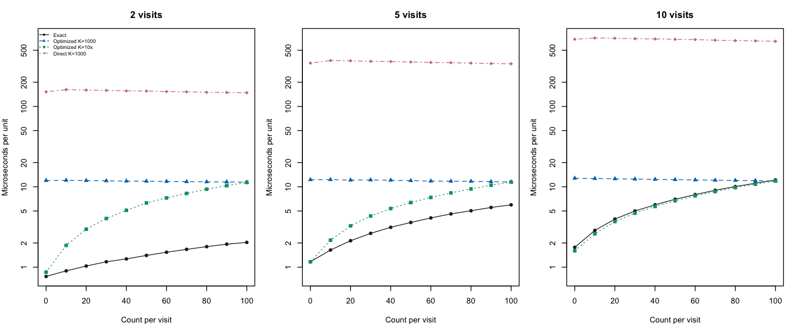
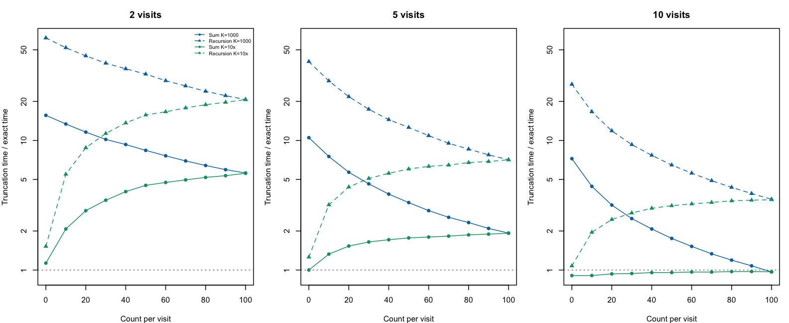

## Refreshing this cached article

The executable source is `nmix_benchmark.Rmd.orig`; the `.Rmd` is a
static snapshot for rendering without rerunning Stan or timings. Both live
under `vignettes/articles`, which is excluded from the CRAN source package.
Edit the `.orig` and regenerate the `.Rmd` only when new timings are wanted.

To refresh this article alone and render its cached HTML, run from the package root:

```r
source("inst/cache_vignettes.R")
cache_vignettes("nmix_benchmark", render_html = TRUE)
```

Omit `render_html = TRUE` to update only the cached `.Rmd`. Pass a vector of
vignette names to refresh a selection. Calling `cache_vignettes()` without a
selection refreshes all registered vignettes, including the long SBC articles;
sourcing the script itself does not run anything.

## Purpose and assumptions

This development benchmark compares the current exact Poisson/binomial
N-mixture likelihood with two implementations that sum over abundance through
**N = 1,000**, inclusive:

1. The exact likelihood, with log coefficients precomputed in R.
2. Optimized truncation, with log combinatorial weights precomputed in R and
   a vectorized log-sum-exp during evaluation.
3. Direct truncation, calling the Poisson and binomial log PMFs at every
   possible abundance.

Every visit within a unit has the same observed count: 0, 10, ..., 100.
We consider 2, 5, and 10 visits. Detection probability is 0.5 throughout,
and expected abundance is `max(1, 2 * count)`. The truncation starts at the
observed maximum and does not renormalize the Poisson distribution. These
parameter settings leave negligible probability above the fixed cutoff. A
separate check below uses `K = max(10, 10 * count)` for optimized truncation
only, so the zero-count case uses a cutoff of 10.

Timings include likelihood evaluation and reverse-mode differentiation through
`rstan::grad_log_prob()`. Each call evaluates 20 identical units to amortize
R-interface overhead; results are divided by 20. Five timing blocks per
method use rotating method order and calibration to approximately 0.15 seconds
or more per block. We report the median. Garbage collection occurs outside
timed blocks. Compilation and initialization are excluded. R coefficient
precomputation is timed separately; very short times may round to zero.

Before timing each configuration, likelihoods and all parameter gradients
must agree to absolute tolerance `1e-7`. These are local likelihood-kernel
measurements, not whole-model fitting speedups. Both the exact polynomial
evaluation and the optimized truncated sum use vectorized expressions with
precomputed data-only coefficients and powers.

## Setup

Knit this document from the flocker source checkout. It requires the development
N-mixture helpers, `pkgload`, `rstan`, and a working Stan C++ toolchain. The full
benchmark takes several minutes. It does not run the package test suite or SBC.
This article is excluded from the CRAN source package by `.Rbuildignore`.

By default, diagnostic files and CSV results go into a fresh temporary directory.
Supply `params = list(output_dir = "/path/to/results")` to `rmarkdown::render()`
to retain them elsewhere. No fitted-model objects are saved.


``` r
# Keep plots with the excluded development article, not in the CRAN package.
knitr::opts_chunk$set(fig.path = 'figures/nmix_benchmark/', fig.retina = 2)
# Find the checkout from the document directory or another directory within it.
package_root <- normalizePath(getwd())
while (!file.exists(file.path(package_root, 'DESCRIPTION'))) {
  parent <- dirname(package_root)
  if (identical(parent, package_root)) stop('Render from within the flocker checkout.')
  package_root <- parent
}
stopifnot(read.dcf(file.path(package_root, 'DESCRIPTION'))[1, 'Package'] == 'flocker')
pkgload::load_all(package_root, helpers = FALSE, quiet = TRUE)
library(rstan)
output_dir <- params$output_dir
if (is.null(output_dir)) output_dir <- tempfile('flocker-nmix-benchmark-')
dir.create(output_dir, recursive = TRUE, showWarnings = FALSE)
output_dir <- normalizePath(output_dir, mustWork = TRUE)
```

## Stan implementations

The exact implementation is read directly from the package's `.stan` file.
All four methods, including the recursion described below, share the same
compiled model and parameterization.


``` r
source_code <- paste(readLines(system.file('stan', 'nmix_poisson_binomial.stan', package = 'flocker', mustWork = TRUE)), collapse='\n')
code <- paste0('functions {', source_code, '
 real nmix_poisson_binomial_truncated_lpmf(array[] int y, vector eta, real log_lambda, int K) {
   int M = max(y);
   vector[K-M+1] terms;
   for (n in M:K) {
     terms[n-M+1] = poisson_log_lpmf(n | log_lambda);
     for (t in 1:num_elements(y))
       terms[n-M+1] += binomial_logit_lpmf(y[t] | n, eta[t]);
   }
   return log_sum_exp(terms);
 }
 real nmix_poisson_binomial_truncated_precomputed_lpmf(array[] int y, vector eta, real log_lambda,
                                  int M, vector log_weights, vector excess) {
   real log_q = sum(log1m_inv_logit(eta));
   real base = M * log_lambda - exp(log_lambda);
   for (t in 1:num_elements(y))
     base += y[t]*log_inv_logit(eta[t]) + (M-y[t])*log1m_inv_logit(eta[t]);
   return base + log_sum_exp(log_weights + excess * (log_lambda + log_q));
 }
 // Section 3 recursion generalized to visit-specific binomial detection.
 // log_ratio_factors contains (T-1)*log(N) - sum(log(N-y[t])),
 // for N=M+1,...,K, precomputed in R. Recurse backward on the log scale.
 real nmix_poisson_binomial_truncated_recursive_lpmf(array[] int y, vector eta, real log_lambda,
                               int M, real log_weight_start, vector log_ratio_factors) {
   real log_theta = log_lambda + sum(log1m_inv_logit(eta));
   real base = M * log_lambda - exp(log_lambda) + log_weight_start;
   real log_nested_sum = 0;
   int steps = num_elements(log_ratio_factors);
   for (t in 1:num_elements(y))
     base += y[t]*log_inv_logit(eta[t]) + (M-y[t])*log1m_inv_logit(eta[t]);
   if (steps > 0) {
     for (i in 1:steps) {
       int j = steps - i + 1;
       log_nested_sum = log1p_exp(log_theta + log_ratio_factors[j] + log_nested_sum);
     }
   }
   return base + log_nested_sum;
 }
}
data {
 int T; array[T] int y; int M; int C; vector[C] lc; vector[C] coef_power; real lf;
 int K; vector[K-M+1] log_weights; vector[K-M+1] excess;
 vector[K-M] log_ratio_factors;
 int method; int batch;
}
parameters { real log_lambda; vector[T] eta; }
model {
 for (i in 1:batch) {
   if (method == 1) target += nmix_poisson_binomial_unit_lpmf(y | eta, log_lambda, M, lf, lc, coef_power);
   else if (method == 2) target += nmix_poisson_binomial_truncated_precomputed_lpmf(y | eta, log_lambda, M, log_weights, excess);
   else if (method == 3) target += nmix_poisson_binomial_truncated_lpmf(y | eta, log_lambda, K);
   else target += nmix_poisson_binomial_truncated_recursive_lpmf(y | eta, log_lambda, M, log_weights[1], log_ratio_factors);
 }
}')
writeLines(code, file.path(output_dir, 'benchmark.stan'))
```


``` r
sm <- stan_model(model_code = code)
```

## Run the benchmark

The single fixed-parameter iteration initializes the Stan model so its density
and gradient methods can be called. It does not perform posterior sampling.


``` r
results <- list()
exact_reference <- list()
# Parameter-independent factors for successive-term ratios. When K=M the
# empty vector makes the recursion return the single starting term.
nmix_poisson_binomial_recursion_factors <- function(y, K) {
  N <- seq.int(max(y), K)[-1]
  as.array((length(y) - 1) * log(N) -
    vapply(N, function(n) sum(log(n - y)), numeric(1)))
}
idx <- 0L
batch <- 20L
timed <- function(f, calls) {
  unname(system.time(for (i in seq_len(calls)) f())[['elapsed']])
}
for (T in c(2L,5L,10L)) for (count in seq.int(0L,100L,10L)) {
  y <- rep(count,T)
  # Positive abundance even for all-zero histories; far below the cutoff.
  lambda <- max(1,2*count)
  eta <- rep(0,T)
  pars <- c(log(lambda),eta)
  pre_calls <- 20L
  prep_ms <- 1000*timed(function() nmix_binomial_log_coefficients(y),pre_calls)/pre_calls
  lc <- nmix_binomial_log_coefficients(y)
  N <- count:1000L
  weights <- -lgamma(N+1)
  for (n in y) weights <- weights + lchoose(N,n)
  d <- list(T=T,y=as.array(y),M=count,C=length(lc),lc=as.array(lc),
    coef_power=as.array(as.numeric(seq_along(lc)-1L)),
    lf=sum(lgamma(y+1)),K=1000L,log_weights=as.array(weights),
    excess=as.array(as.numeric(N-count)),batch=batch,
    log_ratio_factors=nmix_poisson_binomial_recursion_factors(y, 1000L))
  fits <- lapply(1:3,function(method) sampling(sm,data=c(d,list(method=method)),
    algorithm='Fixed_param',chains=1,iter=1,warmup=0,refresh=0,seed=1,
    init=list(list(log_lambda=log(lambda),eta=as.array(eta)))))
  lp <- vapply(fits,function(f) log_prob(f,pars),numeric(1))/batch
  grad <- lapply(fits,function(f) as.numeric(grad_log_prob(f,pars))/batch)
  stopifnot(max(abs(lp-lp[1]))<1e-7,
            max(abs(grad[[1]]-grad[[2]]))<1e-7,
            max(abs(grad[[1]]-grad[[3]]))<1e-7)
  for (f in fits) for (i in 1:5) grad_log_prob(f,pars)
  # Calibrate to >= 0.15 seconds per timing block to avoid clock granularity.
  calls <- vapply(fits,function(f) {
    elapsed <- timed(function() grad_log_prob(f,pars),10L)
    as.integer(max(10,ceiling(10*0.15/max(elapsed,0.001))))
  },integer(1))
  times <- matrix(NA_real_,5,3)
  for (round in 1:5) for (method in ((seq_len(3)+round-2) %% 3)+1) {
    gc()
    times[round,method] <- 1e6*timed(function() grad_log_prob(fits[[method]],pars),calls[method])/
      calls[method]/batch
  }
  idx <- idx+1L
  # Retain exact values, gradients, and inputs for the separate cutoff check.
  # This avoids rerunning or retiming the exact method in that check.
  exact_reference[[paste(T, count, sep = '_')]] <- list(
    data = d, pars = pars, lp = lp[1], gradient = grad[[1]],
    optimized_lp = lp[2], optimized_gradient = grad[[2]])
  results[[idx]] <- data.frame(visits=T,count=count,degree=length(lc)-1,
    lambda=lambda,precompute_ms=prep_ms,
    exact_us=median(times[,1]),truncated_precomputed_us=median(times[,2]),
    truncated_direct_us=median(times[,3]),
    optimized_speedup=median(times[,2])/median(times[,1]),
    direct_speedup=median(times[,3])/median(times[,1]),
    max_loglik_difference=max(abs(lp-lp[1])),
    max_gradient_difference=max(abs(grad[[1]]-grad[[2]]),abs(grad[[1]]-grad[[3]])))
  saveRDS(list(results=results,times=times,calls=calls),file.path(output_dir, 'progress.rds'))
  write.csv(do.call(rbind,results),file.path(output_dir, 'results.csv'),row.names=FALSE)
  cat(sprintf('visits=%d count=%d exact=%.2fus optimized=%.2fus direct=%.2fus ratio=%.2fx\n',
      T,count,median(times[,1]),median(times[,2]),median(times[,3]),median(times[,2])/median(times[,1])))
  flush.console()
}
```

```
## visits=2 count=0 exact=0.77us optimized=11.98us direct=152.04us ratio=15.62x
## visits=2 count=10 exact=0.90us optimized=12.05us direct=161.70us ratio=13.39x
## visits=2 count=20 exact=1.03us optimized=11.98us direct=159.57us ratio=11.59x
## visits=2 count=30 exact=1.17us optimized=11.88us direct=158.16us ratio=10.18x
## visits=2 count=40 exact=1.27us optimized=11.78us direct=156.12us ratio=9.30x
## visits=2 count=50 exact=1.40us optimized=11.73us direct=155.32us ratio=8.38x
## visits=2 count=60 exact=1.53us optimized=11.67us direct=153.06us ratio=7.61x
## visits=2 count=70 exact=1.67us optimized=11.58us direct=152.04us ratio=6.95x
## visits=2 count=80 exact=1.80us optimized=11.53us direct=150.00us ratio=6.41x
## visits=2 count=90 exact=1.93us optimized=11.50us direct=148.98us ratio=5.95x
## visits=2 count=100 exact=2.03us optimized=11.40us direct=147.96us ratio=5.61x
## visits=5 count=0 exact=1.17us optimized=12.25us direct=345.45us ratio=10.50x
## visits=5 count=10 exact=1.63us optimized=12.28us direct=372.50us ratio=7.52x
## visits=5 count=20 exact=2.13us optimized=12.12us direct=369.05us ratio=5.68x
## visits=5 count=30 exact=2.63us optimized=12.18us direct=364.29us ratio=4.62x
## visits=5 count=40 exact=3.13us optimized=12.07us direct=361.90us ratio=3.85x
## visits=5 count=50 exact=3.60us optimized=11.93us direct=357.14us ratio=3.31x
## visits=5 count=60 exact=4.10us optimized=11.78us direct=352.27us ratio=2.87x
## visits=5 count=70 exact=4.60us optimized=11.73us direct=350.00us ratio=2.55x
## visits=5 count=80 exact=5.03us optimized=11.70us direct=345.45us ratio=2.32x
## visits=5 count=90 exact=5.53us optimized=11.58us direct=341.30us ratio=2.09x
## visits=5 count=100 exact=5.97us optimized=11.50us direct=339.13us ratio=1.93x
## visits=10 count=0 exact=1.77us optimized=12.77us direct=685.00us ratio=7.23x
## visits=10 count=10 exact=2.87us optimized=12.67us direct=709.09us ratio=4.42x
## visits=10 count=20 exact=3.97us optimized=12.57us direct=704.55us ratio=3.17x
## visits=10 count=30 exact=5.00us optimized=12.48us direct=695.45us ratio=2.50x
## visits=10 count=40 exact=5.97us optimized=12.38us direct=690.91us ratio=2.07x
## visits=10 count=50 exact=7.00us optimized=12.28us direct=683.33us ratio=1.75x
## visits=10 count=60 exact=8.00us optimized=12.18us direct=679.17us ratio=1.52x
## visits=10 count=70 exact=9.05us optimized=12.08us direct=666.67us ratio=1.33x
## visits=10 count=80 exact=10.07us optimized=12.00us direct=658.33us ratio=1.19x
## visits=10 count=90 exact=11.08us optimized=11.93us direct=654.17us ratio=1.08x
## visits=10 count=100 exact=12.18us optimized=11.78us direct=645.83us ratio=0.97x
```

## Results

Ratios above one mean that the exact implementation is faster; ratios below
one mean truncation is faster. Ratios close to one should be treated as a tie
unless repeated measurements establish a difference.


``` r
results <- do.call(rbind, results)
speedups <- reshape(results[c('count', 'visits', 'optimized_speedup')],
                    idvar = 'count', timevar = 'visits', direction = 'wide')
names(speedups) <- c('Count per visit', '2 visits', '5 visits', '10 visits')
knitr::kable(speedups, digits = 2, row.names = FALSE,
             caption = 'Exact speedup relative to optimized truncation')
```


Table: Exact speedup relative to optimized truncation

| Count per visit| 2 visits| 5 visits| 10 visits|
|---------------:|--------:|--------:|---------:|
|               0|    15.62|    10.50|      7.23|
|              10|    13.39|     7.52|      4.42|
|              20|    11.59|     5.68|      3.17|
|              30|    10.18|     4.62|      2.50|
|              40|     9.30|     3.85|      2.07|
|              50|     8.38|     3.31|      1.75|
|              60|     7.61|     2.87|      1.52|
|              70|     6.95|     2.55|      1.33|
|              80|     6.41|     2.32|      1.19|
|              90|     5.95|     2.09|      1.08|
|             100|     5.61|     1.93|      0.97|


``` r
knitr::kable(results[c('visits', 'count', 'precompute_ms', 'exact_us',
                       'truncated_precomputed_us', 'truncated_direct_us')],
             digits = 3, row.names = FALSE,
             caption = 'Precomputation in milliseconds; gradient evaluation in microseconds per unit')
```


Table: Precomputation in milliseconds; gradient evaluation in microseconds per unit

| visits| count| precompute_ms| exact_us| truncated_precomputed_us| truncated_direct_us|
|------:|-----:|-------------:|--------:|------------------------:|-------------------:|
|      2|     0|          0.35|    0.767|                   11.976|             152.041|
|      2|    10|          0.05|    0.900|                   12.051|             161.702|
|      2|    20|          0.15|    1.033|                   11.976|             159.574|
|      2|    30|          0.20|    1.167|                   11.876|             158.163|
|      2|    40|          0.25|    1.267|                   11.776|             156.122|
|      2|    50|          0.30|    1.400|                   11.733|             155.319|
|      2|    60|          0.40|    1.533|                   11.667|             153.061|
|      2|    70|          0.50|    1.667|                   11.577|             152.041|
|      2|    80|          0.55|    1.800|                   11.533|             150.000|
|      2|    90|          0.60|    1.933|                   11.500|             148.980|
|      2|   100|          0.70|    2.033|                   11.400|             147.959|
|      5|     0|          0.00|    1.167|                   12.250|             345.455|
|      5|    10|          0.25|    1.633|                   12.275|             372.500|
|      5|    20|          0.55|    2.133|                   12.117|             369.048|
|      5|    30|          0.85|    2.633|                   12.176|             364.286|
|      5|    40|          1.30|    3.133|                   12.067|             361.905|
|      5|    50|          1.60|    3.600|                   11.933|             357.143|
|      5|    60|          2.10|    4.100|                   11.776|             352.273|
|      5|    70|          2.60|    4.600|                   11.733|             350.000|
|      5|    80|          2.90|    5.033|                   11.700|             345.455|
|      5|    90|          3.40|    5.533|                   11.585|             341.304|
|      5|   100|          3.85|    5.967|                   11.500|             339.130|
|     10|     0|          0.00|    1.767|                   12.774|             685.000|
|     10|    10|          0.65|    2.867|                   12.675|             709.091|
|     10|    20|          1.50|    3.967|                   12.575|             704.545|
|     10|    30|          2.40|    5.000|                   12.475|             695.455|
|     10|    40|          3.70|    5.967|                   12.375|             690.909|
|     10|    50|          5.60|    7.000|                   12.275|             683.333|
|     10|    60|          7.00|    8.000|                   12.176|             679.167|
|     10|    70|          9.15|    9.055|                   12.076|             666.667|
|     10|    80|         11.10|   10.067|                   12.000|             658.333|
|     10|    90|         13.35|   11.078|                   11.933|             654.167|
|     10|   100|         27.80|   12.184|                   11.776|             645.833|


``` r
c(max_loglik_difference = max(results$max_loglik_difference),
  max_gradient_difference = max(results$max_gradient_difference))
```

```
##   max_loglik_difference max_gradient_difference 
##            2.891909e-12            1.226397e-11
```

``` r
output_dir
```

```
## [1] "/private/var/folders/52/5l_0lt6d73j_p9p24drhyly00000gn/T/RtmpggAevW/flocker-nmix-benchmark-1757b8b5143e"
```

## Optimized truncation with a count-dependent cutoff

This separate check times **only the optimized truncated likelihood**, using
`K = max(10, 10 * count)` instead of 1,000. It reuses the compiled model and the exact
values, gradients, and timings from the first benchmark. Detection probabilities,
abundance means, batches, warmup calls, and timing calibration are unchanged.
The comparison therefore uses separate timing blocks, not interleaved timings
between the two cutoff rules.

For count zero, we use `K = 10` because positive abundance can produce
all-zero observations. We report approximation errors and flag any speedup
for an inaccurate approximation. Unlike the fixed-cutoff benchmark, this
check records agreement rather than asserting it. The error
columns are absolute differences from the exact per-unit log likelihood and
the largest absolute difference across its parameter gradients.


``` r
count_cutoff_results <- list()
count_cutoff_reference <- list()
for (key in names(exact_reference)) {
  reference <- exact_reference[[key]]
  d <- reference$data
  pars <- reference$pars
  count <- d$M
  d$K <- as.integer(max(10L, 10L * count))
  N <- seq.int(count, d$K)
  weights <- -lgamma(N + 1)
  for (n in d$y) weights <- weights + lchoose(N, n)
  d$log_weights <- as.array(weights)
  d$excess <- as.array(as.numeric(N - count))
  d$log_ratio_factors <- nmix_poisson_binomial_recursion_factors(d$y, d$K)
  fit <- sampling(sm, data = c(d, list(method = 2L)),
    algorithm = 'Fixed_param', chains = 1, iter = 1, warmup = 0,
    refresh = 0, seed = 1,
    init = list(list(log_lambda = pars[1], eta = as.array(pars[-1]))))
  lp <- log_prob(fit, pars) / d$batch
  gradient <- as.numeric(grad_log_prob(fit, pars)) / d$batch
  count_cutoff_reference[[key]] <- list(data = d, lp = lp, gradient = gradient)
  lp_error <- abs(lp - reference$lp)
  gradient_error <- max(abs(gradient - reference$gradient))
  for (i in 1:5) grad_log_prob(fit, pars)
  elapsed <- timed(function() grad_log_prob(fit, pars), 10L)
  calls <- as.integer(max(10, ceiling(10 * 0.15 / max(elapsed, 0.001))))
  times <- numeric(5)
  for (round in 1:5) {
    gc()
    times[round] <- 1e6 * timed(function() grad_log_prob(fit, pars), calls) /
      calls / d$batch
  }
  count_cutoff_results[[key]] <- data.frame(
    visits = d$T, count = count, cutoff = d$K,
    count_cutoff_us = median(times),
    loglik_error = lp_error, gradient_error = gradient_error,
    agrees = lp_error < 1e-7 && gradient_error < 1e-7)
  write.csv(do.call(rbind, count_cutoff_results),
            file.path(output_dir, 'count-cutoff-results.csv'), row.names = FALSE)
}
count_cutoff_results <- do.call(rbind, count_cutoff_results)
comparison <- merge(results, count_cutoff_results, by = c('visits', 'count'))
comparison <- comparison[order(comparison$visits, comparison$count), ]
comparison$count_cutoff_speedup <- comparison$count_cutoff_us / comparison$exact_us
write.csv(comparison, file.path(output_dir, 'cutoff-comparison.csv'), row.names = FALSE)
```

### Timing and accuracy comparison

The labels "10x" below include the minimum cutoff of 10.

Both speedup columns use truncation time divided by exact time: values above
one favor the exact method. Rows marked `agrees = FALSE` compare computations
that are not numerically equivalent at the tested parameter values.


``` r
knitr::kable(comparison[c('visits', 'count', 'cutoff', 'exact_us',
  'truncated_precomputed_us', 'count_cutoff_us', 'optimized_speedup',
  'count_cutoff_speedup', 'agrees')], digits = 3, row.names = FALSE,
  col.names = c('Visits', 'Count', '10x cutoff', 'Exact (us)',
    'Optimized K=1000 (us)', 'Optimized K=10x (us)', 'Exact speedup vs K=1000',
    'Exact speedup vs K=10x', 'Agrees'),
  caption = 'Gradient timings per unit and exact-method speedups')
```


Table: Gradient timings per unit and exact-method speedups

| Visits| Count| 10x cutoff| Exact (us)| Optimized K=1000 (us)| Optimized K=10x (us)| Exact speedup vs K=1000| Exact speedup vs K=10x|Agrees |
|------:|-----:|----------:|----------:|---------------------:|--------------------:|-----------------------:|----------------------:|:------|
|      2|     0|         10|      0.767|                11.976|                0.867|                  15.621|                  1.130|TRUE   |
|      2|    10|        100|      0.900|                12.051|                1.867|                  13.390|                  2.074|TRUE   |
|      2|    20|        200|      1.033|                11.976|                2.967|                  11.590|                  2.871|TRUE   |
|      2|    30|        300|      1.167|                11.876|                4.033|                  10.180|                  3.457|TRUE   |
|      2|    40|        400|      1.267|                11.776|                5.100|                   9.297|                  4.026|TRUE   |
|      2|    50|        500|      1.400|                11.733|                6.300|                   8.381|                  4.500|TRUE   |
|      2|    60|        600|      1.533|                11.667|                7.267|                   7.609|                  4.739|TRUE   |
|      2|    70|        700|      1.667|                11.577|                8.267|                   6.946|                  4.960|TRUE   |
|      2|    80|        800|      1.800|                11.533|                9.333|                   6.407|                  5.185|TRUE   |
|      2|    90|        900|      1.933|                11.500|               10.333|                   5.948|                  5.345|TRUE   |
|      2|   100|       1000|      2.033|                11.400|               11.333|                   5.607|                  5.574|TRUE   |
|      5|     0|         10|      1.167|                12.250|                1.167|                  10.500|                  1.000|TRUE   |
|      5|    10|        100|      1.633|                12.275|                2.167|                   7.516|                  1.327|TRUE   |
|      5|    20|        200|      2.133|                12.117|                3.267|                   5.680|                  1.531|TRUE   |
|      5|    30|        300|      2.633|                12.176|                4.333|                   4.624|                  1.646|TRUE   |
|      5|    40|        400|      3.133|                12.067|                5.367|                   3.851|                  1.713|TRUE   |
|      5|    50|        500|      3.600|                11.933|                6.367|                   3.315|                  1.769|TRUE   |
|      5|    60|        600|      4.100|                11.776|                7.367|                   2.872|                  1.797|TRUE   |
|      5|    70|        700|      4.600|                11.733|                8.400|                   2.551|                  1.826|TRUE   |
|      5|    80|        800|      5.033|                11.700|                9.400|                   2.325|                  1.868|TRUE   |
|      5|    90|        900|      5.533|                11.585|               10.467|                   2.094|                  1.892|TRUE   |
|      5|   100|       1000|      5.967|                11.500|               11.467|                   1.927|                  1.922|TRUE   |
|     10|     0|         10|      1.767|                12.774|                1.600|                   7.231|                  0.906|TRUE   |
|     10|    10|        100|      2.867|                12.675|                2.600|                   4.421|                  0.907|TRUE   |
|     10|    20|        200|      3.967|                12.575|                3.700|                   3.170|                  0.933|TRUE   |
|     10|    30|        300|      5.000|                12.475|                4.700|                   2.495|                  0.940|TRUE   |
|     10|    40|        400|      5.967|                12.375|                5.700|                   2.074|                  0.955|TRUE   |
|     10|    50|        500|      7.000|                12.275|                6.700|                   1.754|                  0.957|TRUE   |
|     10|    60|        600|      8.000|                12.176|                7.723|                   1.522|                  0.965|TRUE   |
|     10|    70|        700|      9.055|                12.076|                8.733|                   1.334|                  0.965|TRUE   |
|     10|    80|        800|     10.067|                12.000|                9.787|                   1.192|                  0.972|TRUE   |
|     10|    90|        900|     11.078|                11.933|               10.786|                   1.077|                  0.974|TRUE   |
|     10|   100|       1000|     12.184|                11.776|               11.800|                   0.967|                  0.969|TRUE   |

``` r
knitr::kable(comparison[c('visits', 'count', 'loglik_error', 'gradient_error')],
  digits = 12, row.names = FALSE,
  caption = 'Absolute errors for the count-dependent cutoff relative to exact evaluation')
```


Table: Absolute errors for the count-dependent cutoff relative to exact evaluation

| visits| count| loglik_error| gradient_error|
|------:|-----:|------------:|--------------:|
|      2|     0|        0e+00|        0.0e+00|
|      2|    10|        0e+00|        0.0e+00|
|      2|    20|        0e+00|        0.0e+00|
|      2|    30|        0e+00|        0.0e+00|
|      2|    40|        0e+00|        0.0e+00|
|      2|    50|        0e+00|        0.0e+00|
|      2|    60|        0e+00|        1.0e-12|
|      2|    70|        0e+00|        1.0e-12|
|      2|    80|        0e+00|        0.0e+00|
|      2|    90|        0e+00|        2.0e-12|
|      2|   100|        0e+00|        3.0e-12|
|      5|     0|        0e+00|        0.0e+00|
|      5|    10|        0e+00|        0.0e+00|
|      5|    20|        0e+00|        0.0e+00|
|      5|    30|        0e+00|        0.0e+00|
|      5|    40|        0e+00|        2.0e-12|
|      5|    50|        0e+00|        0.0e+00|
|      5|    60|        0e+00|        2.0e-12|
|      5|    70|        0e+00|        7.0e-12|
|      5|    80|        0e+00|        6.0e-12|
|      5|    90|        0e+00|        3.0e-12|
|      5|   100|        0e+00|        6.0e-12|
|     10|     0|        0e+00|        0.0e+00|
|     10|    10|        0e+00|        0.0e+00|
|     10|    20|        0e+00|        0.0e+00|
|     10|    30|        0e+00|        1.0e-12|
|     10|    40|        2e-12|        2.0e-12|
|     10|    50|        3e-12|        2.0e-12|
|     10|    60|        0e+00|        1.0e-11|
|     10|    70|        2e-12|        1.0e-11|
|     10|    80|        2e-12|        1.2e-11|
|     10|    90|        1e-12|        3.0e-12|
|     10|   100|        2e-12|        6.0e-12|

The plot includes the original direct truncation for context. Times use a
logarithmic scale; red crosses flag count-dependent timings whose likelihood
or gradient failed the agreement tolerance.


``` r
local({
  old_par <- par(mfrow = c(1, 3), mar = c(4, 4, 3, 1))
  on.exit(par(old_par))
  colors <- c('#222222', '#0072B2', '#009E73', '#CC79A7')
  columns <- c('exact_us', 'truncated_precomputed_us',
               'count_cutoff_us', 'truncated_direct_us')
  limits <- range(as.matrix(comparison[columns]))
  for (visits in sort(unique(comparison$visits))) {
    panel <- comparison[comparison$visits == visits, ]
    matplot(panel$count, as.matrix(panel[columns]), type = 'o', log = 'y',
      lty = c(1, 2, 3, 4), pch = c(16, 17, 15, 18), col = colors,
      ylim = limits, xlab = 'Count per visit', ylab = 'Microseconds per unit',
      main = paste(visits, 'visits'))
    bad <- !panel$agrees
    points(panel$count[bad], panel$count_cutoff_us[bad], pch = 4,
           col = 'red', cex = 1.6, lwd = 2)
    if (visits == min(comparison$visits)) {
      legend('topleft', c('Exact', 'Optimized K=1000', 'Optimized K=10x',
                         'Direct K=1000'), col = colors,
             lty = 1:4, pch = c(16, 17, 15, 18), cex = 0.65, bty = 'n')
    }
  }
})
```

<div class="figure">

<p class="caption">plot of chunk cutoff-comparison-plot</p>
</div>

## Recursive optimized truncation at both cutoffs

Section 3 of Goldstein and de Valpine's supplemental materials for
*Comparing N-mixture models and GLMMs for relative abundance estimation in a
citizen science dataset* (2022; supplement `41598_2022_16368_MOESM1_ESM.pdf`)
describes successive-term ratios and a nested summation adapted from Meehan
et al. The existing optimized benchmark **does not use that recursion**: it
precomputes log combinatorial weights and evaluates all terms with one
vectorized log-sum-exp. Both approaches avoid repeated factorial calculations.

For multiple visits, let
\(a_N = \Pr(N\mid\lambda)\prod_t\Pr(y_t\mid N,p_t)\),
\(M=\max_t y_t\), and \(q=\prod_t(1-p_t)\). Combining the Poisson and
binomial recursions gives, for \(N>M\),

\[
\frac{a_N}{a_{N-1}}
= \lambda q\,\frac{N^{T-1}}{\prod_t(N-y_t)} = r_N.
\]

Thus the truncated likelihood is
\(a_M[1+r_{M+1}(1+r_{M+2}(\ldots(1+r_K)\ldots))]\).
The data-only quantity \((T-1)\log N-\sum_t\log(N-y_t)\) is precomputed in R.
Starting with \(s=0\), we work backward from \(N=K\) to \(M+1\), updating
\(s=\log(1+\exp(\log r_N+s))\), and finally return \(\log a_M+s\).
`log1p_exp` makes the recursion stable without forming tiny probabilities or
large products. This is the multiple-visit version of the nested recursion;
the single-observation factor in the supplement cannot be used unchanged.

The new pair of benchmarks times **only method 4**, at `K=1000` and
`K=max(10, 10*count)`. It reuses earlier exact and optimized-sum results.
Each recursive result must agree with the existing optimized implementation
at the **same cutoff** to `1e-7` in log likelihood and gradients before it is
timed. Its error relative to the exact likelihood is recorded separately,
so truncation error is not mistaken for a recursion error. Data preparation
is outside the timed gradient calls, as for the other optimized methods.
The two recursive cutoff settings are timed in alternating order across five
blocks; comparisons with earlier methods still use separate benchmark runs.


``` r
recursive_results <- list()
for (key in names(exact_reference)) {
  reference <- exact_reference[[key]]
  pars <- reference$pars
  configurations <- list(
    fixed = list(data = reference$data, lp = reference$optimized_lp,
                 gradient = reference$optimized_gradient),
    count = count_cutoff_reference[[key]])
  fits <- lapply(configurations, function(configuration) {
    sampling(sm, data = c(configuration$data, list(method = 4L)),
      algorithm = 'Fixed_param', chains = 1, iter = 1, warmup = 0,
      refresh = 0, seed = 1,
      init = list(list(log_lambda = pars[1], eta = as.array(pars[-1]))))
  })
  checks <- lapply(seq_along(fits), function(i) {
    d <- configurations[[i]]$data
    lp <- log_prob(fits[[i]], pars) / d$batch
    gradient <- as.numeric(grad_log_prob(fits[[i]], pars)) / d$batch
    same_cutoff_lp_error <- abs(lp - configurations[[i]]$lp)
    same_cutoff_gradient_error <- max(abs(gradient - configurations[[i]]$gradient))
    stopifnot(same_cutoff_lp_error < 1e-7, same_cutoff_gradient_error < 1e-7)
    c(loglik_error = abs(lp - reference$lp),
      gradient_error = max(abs(gradient - reference$gradient)),
      same_cutoff_loglik_error = same_cutoff_lp_error,
      same_cutoff_gradient_error = same_cutoff_gradient_error)
  })
  for (fit in fits) for (i in 1:5) grad_log_prob(fit, pars)
  calls <- vapply(fits, function(fit) {
    elapsed <- timed(function() grad_log_prob(fit, pars), 10L)
    as.integer(max(10, ceiling(10 * 0.15 / max(elapsed, 0.001))))
  }, integer(1))
  times <- matrix(NA_real_, 5, 2)
  for (round in 1:5) for (i in if (round %% 2) 1:2 else 2:1) {
    gc()
    times[round, i] <- 1e6 * timed(function() grad_log_prob(fits[[i]], pars), calls[i]) /
      calls[i] / configurations[[i]]$data$batch
  }
  for (i in seq_along(fits)) {
    d <- configurations[[i]]$data
    errors <- checks[[i]]
    recursive_results[[paste(key, names(configurations)[i], sep = '_')]] <- data.frame(
      visits = d$T, count = d$M, cutoff_rule = names(configurations)[i], cutoff = d$K,
      recursive_us = median(times[, i]),
      loglik_error = errors[['loglik_error']],
      gradient_error = errors[['gradient_error']],
      same_cutoff_loglik_error = errors[['same_cutoff_loglik_error']],
      same_cutoff_gradient_error = errors[['same_cutoff_gradient_error']],
      agrees = errors[['loglik_error']] < 1e-7 && errors[['gradient_error']] < 1e-7)
  }
  write.csv(do.call(rbind, recursive_results),
            file.path(output_dir, 'recursive-results.csv'), row.names = FALSE)
}
recursive_results <- do.call(rbind, recursive_results)
recursive_comparison <- merge(comparison, reshape(
  recursive_results[c('visits', 'count', 'cutoff_rule', 'recursive_us', 'agrees')],
  idvar = c('visits', 'count'), timevar = 'cutoff_rule', direction = 'wide'),
  by = c('visits', 'count'))
recursive_comparison <- recursive_comparison[
  order(recursive_comparison$visits, recursive_comparison$count), ]
recursive_comparison$recursive_fixed_speedup <-
  recursive_comparison$recursive_us.fixed / recursive_comparison$exact_us
recursive_comparison$recursive_count_speedup <-
  recursive_comparison$recursive_us.count / recursive_comparison$exact_us
write.csv(recursive_comparison, file.path(output_dir, 'recursive-comparison.csv'), row.names = FALSE)
```

### All methods side by side


``` r
knitr::kable(recursive_comparison[c('visits', 'count', 'exact_us',
  'truncated_direct_us', 'truncated_precomputed_us', 'recursive_us.fixed',
  'count_cutoff_us', 'recursive_us.count')], digits = 3, row.names = FALSE,
  col.names = c('Visits', 'Count', 'Exact', 'Direct K=1000',
                'Optimized K=1000', 'Recursive K=1000', 'Optimized K=10x',
                'Recursive K=10x'),
  caption = 'Gradient evaluation in microseconds per unit (10x has a minimum of 10)')
```


Table: Gradient evaluation in microseconds per unit (10x has a minimum of 10)

| Visits| Count|  Exact| Direct K=1000| Optimized K=1000| Recursive K=1000| Optimized K=10x| Recursive K=10x|
|------:|-----:|------:|-------------:|----------------:|----------------:|---------------:|---------------:|
|      2|     0|  0.767|       152.041|           11.976|           47.351|           0.867|           1.167|
|      2|    10|  0.900|       161.702|           12.051|           46.707|           1.867|           4.933|
|      2|    20|  1.033|       159.574|           11.976|           46.407|           2.967|           9.067|
|      2|    30|  1.167|       158.163|           11.876|           46.000|           4.033|          13.200|
|      2|    40|  1.267|       156.122|           11.776|           45.210|           5.100|          17.265|
|      2|    50|  1.400|       155.319|           11.733|           45.479|           6.300|          22.000|
|      2|    60|  1.533|       153.061|           11.667|           44.311|           7.267|          25.500|
|      2|    70|  1.667|       152.041|           11.577|           43.883|           8.267|          29.681|
|      2|    80|  1.800|       150.000|           11.533|           43.114|           9.333|          33.953|
|      2|    90|  1.933|       148.980|           11.500|           42.819|          10.333|          38.032|
|      2|   100|  2.033|       147.959|           11.400|           42.021|          11.333|          42.021|
|      5|     0|  1.167|       345.455|           12.250|           47.333|           1.167|           1.467|
|      5|    10|  1.633|       372.500|           12.275|           47.006|           2.167|           5.200|
|      5|    20|  2.133|       369.048|           12.117|           46.407|           3.267|           9.321|
|      5|    30|  2.633|       364.286|           12.176|           45.808|           4.333|          13.400|
|      5|    40|  3.133|       361.905|           12.067|           45.333|           5.367|          17.465|
|      5|    50|  3.600|       357.143|           11.933|           45.333|           6.367|          21.667|
|      5|    60|  4.100|       352.273|           11.776|           44.611|           7.367|          25.833|
|      5|    70|  4.600|       350.000|           11.733|           43.713|           8.400|          29.681|
|      5|    80|  5.033|       345.455|           11.700|           43.114|           9.400|          33.953|
|      5|    90|  5.533|       341.304|           11.585|           42.814|          10.467|          38.032|
|      5|   100|  5.967|       339.130|           11.500|           42.287|          11.467|          42.287|
|     10|     0|  1.767|       685.000|           12.774|           47.904|           1.600|           1.900|
|     10|    10|  2.867|       709.091|           12.675|           47.682|           2.600|           5.600|
|     10|    20|  3.967|       704.545|           12.575|           47.006|           3.700|           9.733|
|     10|    30|  5.000|       695.455|           12.475|           46.407|           4.700|          13.772|
|     10|    40|  5.967|       690.909|           12.375|           45.808|           5.700|          17.867|
|     10|    50|  7.000|       683.333|           12.275|           45.210|           6.700|          21.941|
|     10|    60|  8.000|       679.167|           12.176|           44.702|           7.723|          25.896|
|     10|    70|  9.055|       666.667|           12.076|           44.311|           8.733|          30.080|
|     10|    80| 10.067|       658.333|           12.000|           43.713|           9.787|          34.419|
|     10|    90| 11.078|       654.167|           11.933|           43.114|          10.786|          38.298|
|     10|   100| 12.184|       645.833|           11.776|           42.819|          11.800|          42.515|

``` r
knitr::kable(recursive_results[c('visits', 'count', 'cutoff_rule',
  'same_cutoff_loglik_error', 'same_cutoff_gradient_error',
  'loglik_error', 'gradient_error', 'agrees')], digits = 12, row.names = FALSE,
  caption = 'Recursion agreement with the optimized sum and error relative to exact evaluation')
```


Table: Recursion agreement with the optimized sum and error relative to exact evaluation

| visits| count|cutoff_rule | same_cutoff_loglik_error| same_cutoff_gradient_error| loglik_error| gradient_error|agrees |
|------:|-----:|:-----------|------------------------:|--------------------------:|------------:|--------------:|:------|
|      2|     0|fixed       |                        0|                      0e+00|        0e+00|        0.0e+00|TRUE   |
|      2|     0|count       |                        0|                      0e+00|        0e+00|        0.0e+00|TRUE   |
|      2|    10|fixed       |                        0|                      0e+00|        0e+00|        0.0e+00|TRUE   |
|      2|    10|count       |                        0|                      0e+00|        0e+00|        0.0e+00|TRUE   |
|      2|    20|fixed       |                        0|                      0e+00|        0e+00|        0.0e+00|TRUE   |
|      2|    20|count       |                        0|                      0e+00|        0e+00|        0.0e+00|TRUE   |
|      2|    30|fixed       |                        0|                      0e+00|        0e+00|        0.0e+00|TRUE   |
|      2|    30|count       |                        0|                      0e+00|        0e+00|        0.0e+00|TRUE   |
|      2|    40|fixed       |                        0|                      0e+00|        0e+00|        0.0e+00|TRUE   |
|      2|    40|count       |                        0|                      0e+00|        0e+00|        0.0e+00|TRUE   |
|      2|    50|fixed       |                        0|                      0e+00|        0e+00|        0.0e+00|TRUE   |
|      2|    50|count       |                        0|                      0e+00|        0e+00|        0.0e+00|TRUE   |
|      2|    60|fixed       |                        0|                      0e+00|        0e+00|        1.0e-12|TRUE   |
|      2|    60|count       |                        0|                      0e+00|        0e+00|        1.0e-12|TRUE   |
|      2|    70|fixed       |                        0|                      1e-12|        0e+00|        1.0e-12|TRUE   |
|      2|    70|count       |                        0|                      1e-12|        0e+00|        1.0e-12|TRUE   |
|      2|    80|fixed       |                        0|                      1e-12|        0e+00|        1.0e-12|TRUE   |
|      2|    80|count       |                        0|                      1e-12|        0e+00|        1.0e-12|TRUE   |
|      2|    90|fixed       |                        0|                      1e-12|        0e+00|        0.0e+00|TRUE   |
|      2|    90|count       |                        0|                      1e-12|        0e+00|        0.0e+00|TRUE   |
|      2|   100|fixed       |                        0|                      1e-12|        0e+00|        1.0e-12|TRUE   |
|      2|   100|count       |                        0|                      1e-12|        0e+00|        1.0e-12|TRUE   |
|      5|     0|fixed       |                        0|                      0e+00|        0e+00|        0.0e+00|TRUE   |
|      5|     0|count       |                        0|                      0e+00|        0e+00|        0.0e+00|TRUE   |
|      5|    10|fixed       |                        0|                      0e+00|        0e+00|        0.0e+00|TRUE   |
|      5|    10|count       |                        0|                      0e+00|        0e+00|        0.0e+00|TRUE   |
|      5|    20|fixed       |                        0|                      0e+00|        0e+00|        0.0e+00|TRUE   |
|      5|    20|count       |                        0|                      0e+00|        0e+00|        0.0e+00|TRUE   |
|      5|    30|fixed       |                        0|                      0e+00|        0e+00|        0.0e+00|TRUE   |
|      5|    30|count       |                        0|                      0e+00|        0e+00|        0.0e+00|TRUE   |
|      5|    40|fixed       |                        0|                      0e+00|        0e+00|        2.0e-12|TRUE   |
|      5|    40|count       |                        0|                      0e+00|        0e+00|        2.0e-12|TRUE   |
|      5|    50|fixed       |                        0|                      0e+00|        0e+00|        1.0e-12|TRUE   |
|      5|    50|count       |                        0|                      0e+00|        0e+00|        1.0e-12|TRUE   |
|      5|    60|fixed       |                        0|                      0e+00|        0e+00|        2.0e-12|TRUE   |
|      5|    60|count       |                        0|                      0e+00|        0e+00|        2.0e-12|TRUE   |
|      5|    70|fixed       |                        0|                      0e+00|        0e+00|        7.0e-12|TRUE   |
|      5|    70|count       |                        0|                      0e+00|        0e+00|        7.0e-12|TRUE   |
|      5|    80|fixed       |                        0|                      0e+00|        0e+00|        6.0e-12|TRUE   |
|      5|    80|count       |                        0|                      0e+00|        0e+00|        6.0e-12|TRUE   |
|      5|    90|fixed       |                        0|                      0e+00|        1e-12|        3.0e-12|TRUE   |
|      5|    90|count       |                        0|                      0e+00|        1e-12|        3.0e-12|TRUE   |
|      5|   100|fixed       |                        0|                      0e+00|        0e+00|        6.0e-12|TRUE   |
|      5|   100|count       |                        0|                      0e+00|        0e+00|        6.0e-12|TRUE   |
|     10|     0|fixed       |                        0|                      0e+00|        0e+00|        0.0e+00|TRUE   |
|     10|     0|count       |                        0|                      0e+00|        0e+00|        0.0e+00|TRUE   |
|     10|    10|fixed       |                        0|                      0e+00|        0e+00|        0.0e+00|TRUE   |
|     10|    10|count       |                        0|                      0e+00|        0e+00|        0.0e+00|TRUE   |
|     10|    20|fixed       |                        0|                      0e+00|        0e+00|        0.0e+00|TRUE   |
|     10|    20|count       |                        0|                      0e+00|        0e+00|        0.0e+00|TRUE   |
|     10|    30|fixed       |                        0|                      0e+00|        0e+00|        2.0e-12|TRUE   |
|     10|    30|count       |                        0|                      0e+00|        0e+00|        2.0e-12|TRUE   |
|     10|    40|fixed       |                        0|                      0e+00|        2e-12|        3.0e-12|TRUE   |
|     10|    40|count       |                        0|                      0e+00|        2e-12|        3.0e-12|TRUE   |
|     10|    50|fixed       |                        0|                      0e+00|        3e-12|        2.0e-12|TRUE   |
|     10|    50|count       |                        0|                      0e+00|        3e-12|        2.0e-12|TRUE   |
|     10|    60|fixed       |                        0|                      0e+00|        0e+00|        1.1e-11|TRUE   |
|     10|    60|count       |                        0|                      0e+00|        0e+00|        1.1e-11|TRUE   |
|     10|    70|fixed       |                        0|                      1e-12|        2e-12|        1.0e-11|TRUE   |
|     10|    70|count       |                        0|                      1e-12|        2e-12|        1.0e-11|TRUE   |
|     10|    80|fixed       |                        0|                      2e-12|        2e-12|        1.0e-11|TRUE   |
|     10|    80|count       |                        0|                      2e-12|        2e-12|        1.0e-11|TRUE   |
|     10|    90|fixed       |                        0|                      2e-12|        1e-12|        1.0e-12|TRUE   |
|     10|    90|count       |                        0|                      2e-12|        1e-12|        1.0e-12|TRUE   |
|     10|   100|fixed       |                        0|                      2e-12|        2e-12|        7.0e-12|TRUE   |
|     10|   100|count       |                        0|                      2e-12|        2e-12|        7.0e-12|TRUE   |

The plot compares the exact method's speedup over all four optimized
truncation settings. Above one favors exact; below one favors truncation.
Colors distinguish cutoff rules, and line types distinguish vectorized sums
from recursion. Red crosses flag disagreement with the exact likelihood or
gradients. Near-one ratios should be treated as ties.


``` r
local({
  old_par <- par(mfrow = c(1, 3), mar = c(4, 4, 3, 1))
  on.exit(par(old_par))
  columns <- c('optimized_speedup', 'recursive_fixed_speedup',
               'count_cutoff_speedup', 'recursive_count_speedup')
  colors <- c('#0072B2', '#0072B2', '#009E73', '#009E73')
  limits <- range(c(1, as.matrix(recursive_comparison[columns])))
  for (visits in sort(unique(recursive_comparison$visits))) {
    panel <- recursive_comparison[recursive_comparison$visits == visits, ]
    matplot(panel$count, as.matrix(panel[columns]), type = 'o', log = 'y',
      lty = c(1, 2, 1, 2), pch = c(16, 17, 16, 17), col = colors,
      ylim = limits, xlab = 'Count per visit', ylab = 'Truncation time / exact time',
      main = paste(visits, 'visits'))
    abline(h = 1, lty = 3, col = 'grey50')
    valid <- list(rep(TRUE, nrow(panel)), panel$agrees.fixed,
                  panel$agrees, panel$agrees.count)
    for (i in seq_along(columns)) {
      bad <- !valid[[i]]
      points(panel$count[bad], panel[[columns[i]]][bad], pch = 4,
             col = 'red', cex = 1.6, lwd = 2)
    }
    if (visits == min(recursive_comparison$visits)) {
      legend('topright', c('Sum K=1000', 'Recursion K=1000',
                          'Sum K=10x', 'Recursion K=10x'),
             col = colors, lty = c(1, 2, 1, 2), pch = c(16, 17, 16, 17),
             cex = 0.65, bty = 'n')
    }
  }
})
```

<div class="figure">

<p class="caption">plot of chunk recursive-comparison-plot</p>
</div>

## Session information


``` r
writeLines(capture.output(sessionInfo()), file.path(output_dir, 'session.txt'))
sessionInfo()
```

```
## R version 4.5.2 (2025-10-31)
## Platform: aarch64-apple-darwin20
## Running under: macOS Sequoia 15.6.1
## 
## Matrix products: default
## BLAS:   /System/Library/Frameworks/Accelerate.framework/Versions/A/Frameworks/vecLib.framework/Versions/A/libBLAS.dylib 
## LAPACK: /Library/Frameworks/R.framework/Versions/4.5-arm64/Resources/lib/libRlapack.dylib;  LAPACK version 3.12.1
## 
## locale:
## [1] en_US.UTF-8/en_US.UTF-8/en_US.UTF-8/C/en_US.UTF-8/en_US.UTF-8
## 
## time zone: Europe/Paris
## tzcode source: internal
## 
## attached base packages:
## [1] stats     graphics  grDevices utils     datasets  methods   base     
## 
## other attached packages:
## [1] rstan_2.32.7       StanHeaders_2.39.1 flocker_1.1-1      testthat_3.3.2    
## 
## loaded via a namespace (and not attached):
##  [1] tidyselect_1.2.1     dplyr_1.2.1          farver_2.1.2         loo_2.10.1           S7_0.2.2            
##  [6] fastmap_1.2.0        tensorA_0.36.2.1     digest_0.6.39        timechange_0.4.0     lifecycle_1.0.5     
## [11] ellipsis_0.3.2       processx_3.9.0       terra_1.8-93         magrittr_2.0.5       posterior_1.7.0     
## [16] compiler_4.5.2       rlang_1.3.0          tools_4.5.2          yaml_2.3.12          knitr_1.51          
## [21] bridgesampling_1.2-1 pkgbuild_1.4.8       curl_7.0.0           RColorBrewer_1.1-3   pkgload_1.5.0       
## [26] abind_1.4-8          withr_3.0.3          purrr_1.2.2          desc_1.4.3           grid_4.5.2          
## [31] stats4_4.5.2         inline_0.3.21        ggplot2_4.0.3        scales_1.4.0         MASS_7.3-65         
## [36] cli_3.6.6            mvtnorm_1.4-2        rmarkdown_2.30       generics_0.1.4       remotes_2.5.0       
## [41] otel_0.2.0           RcppParallel_6.2.1   rstudioapi_0.18.0    sessioninfo_1.2.3    cachem_1.1.0        
## [46] stringr_1.6.0        bayesplot_1.15.0     assertthat_0.2.1     parallel_4.5.2       matrixStats_1.5.0   
## [51] brms_2.23.0          vctrs_0.7.3          devtools_2.4.6       V8_8.2.0             boot_1.3-32         
## [56] Matrix_1.7-4         jsonlite_2.0.0       callr_3.8.0          glue_1.8.1           codetools_0.2-20    
## [61] distributional_0.8.1 lubridate_1.9.5      stringi_1.8.9        gtable_0.3.6         QuickJSR_1.11.0     
## [66] tibble_3.3.1         pillar_1.11.1        htmltools_0.5.9      brio_1.1.5           Brobdingnag_1.2-9   
## [71] R6_2.6.1             rprojroot_2.1.1      evaluate_1.0.5       lattice_0.22-7       backports_1.5.1     
## [76] memoise_2.0.1        rstantools_2.7.1     Rcpp_1.1.2           coda_0.19-4.1        gridExtra_2.3.1     
## [81] nlme_3.1-168         checkmate_2.3.4      xfun_0.56            fs_1.6.6             usethis_3.2.1       
## [86] pkgconfig_2.0.3
```
